# Photos — editing one photograph: Transform, Adjust, Filter

**Status:** v0.5 — **ED-1…ED-4 shipped** (Transform + *Save as copy*, as-built §9; Adjust + Filter,
as-built §10; the non-destructive *Save*, design + as-built §12; Markup, as-built §11;
Android/desktop/iOS). Opened 2026-11-09 from a maintainer request ("an Edit feature similar to
the one in Google Photos … Transform, Filter, Adjust"). §1 is measured on the maintainer's phone,
2026-11-09.

⭐ **Google's editor is mostly pixel math.** Of its eight tabs, the three this doc proposes (Crop,
Adjust, Filters) are almost entirely sliders and colour transforms with no model behind them, and
a fourth (Markup) is too (§1.2).

⚠⚠ **§3 is the constraint, and it decides the save model before any UI.** Album entries,
favourite/hidden flags and trash records are keyed on `File.ContentId`, and `contentId` is
**re-minted on every content write** (`file-content-addressing.md` §8.12 — "upload + overwrite mint
fresh"). So an edit saved by overwriting the photograph's bytes **silently clears its favourite and
leaves its album memberships half-broken**: still listed, but impossible to remove, and gone after
the next move. Nothing fails at save time.

**Owner:** Benedikt

**Closes:** `photos-app.md` PH-G12's *"no crop/rotate/markup"* half. Its other half — Live Photos,
bursts, RAW+JPEG as one asset — is not editing and stays there.

**Builds on:** [`photos-creation-features.md`](photos-creation-features.md) CR-1 (`encodeToBytes`
in `:ui-core` — the one seam this needs and does not have),
[`photos-viewer-about-screen.md`](photos-viewer-about-screen.md) D6 (the edits to what a file *says*
about itself — caption, location, capture time — which are **not** this doc),
[`file-content-addressing.md`](file-content-addressing.md) (why an overwrite changes identity),
[`inference-service.md`](inference-service.md) (any model-backed tool).

**House rules engaged:** #1 (no server render — every tool is on-device or absent), #4 + #9 (an
edit record is a synced `:photo-service` type), #8.

---

## 1. Google's editor — measured

Driven on the maintainer's OnePlus **CPH2581**, Google Photos **7.99.0.1007655401**, 2026-11-09,
via `uiautomator dump` + `screencap`, on one local photograph (backup is off on this phone). Every
tab was opened and every control list scrolled to its end. **Nothing was saved**: the one change
made (a 90° rotation, to reveal the save button) was cancelled.

### 1.1 Where it is

The viewer has a **bottom action bar — Share · Edit · Add to · Bin** — under a top bar with back,
date and place, ☆ and ⋮. Edit opens a full-screen editor. Its top bar is ✕ (Cancel), the save
button once something has changed, and ⋮ (which holds only *Help and feedback*). Under that is a
**Transform strip that stays visible on every tab**: straighten, crop aspect ratio, mirror, rotate
90° anticlockwise. At the bottom is a scrolling tab row with *Ask* pinned at its start and a tool
search pinned at its end.

### 1.2 The tabs, in order

| Tab | Tools (in order) | Model? |
|---|---|---|
| *Ask* | a free-text prompt ("edit by asking") | ⚠ generative; offline behaviour not tested |
| **Auto** | Enhance · Dynamic · AI enhance (three preview tiles) | Enhance/Dynamic look like auto-adjust; *AI enhance* is a model |
| **Crop** | Crop · Straighten · Rotate · Perspective; aspect: Freeform, Original, Square, 5:4, 4:3, 3:2, 16:9, 4:5, 3:4, 2:3, 9:16 | no |
| **Adjust** | Portrait Light · Brightness · Contrast · Ultra HDR · Tone · White point · Highlights · Shadows · Black point · Saturation · Warmth · Tint · Skin tone · Blue tone · Vignette | **11 of 15 are pixel math.** Portrait Light (relighting), Skin tone and Blue tone (need segmentation) are models; Ultra HDR needs an HDR gain map |
| **Actions** | Portrait Blur · Pop · Sharpen · Denoise | Portrait Blur needs depth/segmentation; the other three can be classical |
| **Markup** | Pen · Highlighter · Redact · Text | no |
| **Filters** | *Filters*: Original, Lite, Playa, Honey, Isla, Desert, Clay, Palma, Blush, Alpaca, Modena, West, Metro, Reel, Bazaar, Ollie, Onyx, Eiffel, Vogue, Vista, Astro (20 looks). *Sky styles* | the looks are colour transforms; Sky styles needs sky segmentation |
| More | hands the photo to another app (OneDrive, ChatGPT, …) | — |

Every slider is the same control: a centred tick dial with a reset button and **Done** under it,
and the tool's name above it. Holding the image shows the original ("Hold image to compare").

### 1.3 Saving

- ⭐ **The only save offered was "Save as copy"**, as the top-bar button. Neither it nor ⋮ offered
  an overwrite. ⚠ This was one *local, not backed-up* photograph; a backed-up one may offer an
  in-place *Save*, and that was not tested. The result agrees with ED-D1 either way.
- ⚠ **✕ discarded the change with no confirmation.** That is Google's choice; this doc does not
  copy it (§7 ED-D6).

### 1.4 What this changes in the proposal

- The maintainer's three families are Google's **Crop, Adjust and Filters** tabs. §2 follows
  Google's tool lists and order, minus the model tools.
- **Markup is a fourth family with no model**, and *Redact* is a privacy tool worth having. It is
  added as a phase after the first three (§8).
- *Auto → Enhance* is the one-call auto-adjust Core Image already has (§5). It belongs with Adjust
  where a platform can do it, and is absent where it can't.

## 2. The tool families this doc proposes (Markup later)

| Family | Tools | Needs a model? |
|---|---|---|
| **Transform** (Google: Crop) | crop with §1.2's eleven aspect presets, straighten, rotate 90°, mirror, perspective. The rotate/mirror/aspect strip stays visible on every tab, as Google's does | no — ⭐ straighten/perspective *suggestions* are optional extras |
| **Adjust** | Google's eleven pixel-math sliders, in Google's order: brightness, contrast, tone, white point, highlights, shadows, black point, saturation, warmth, tint, vignette. *Enhance* where a platform has auto-adjust | no |
| **Filter** | a fixed set of looks (Google has 20), each a 3D LUT plus an intensity | no |
| **Markup** (ED-4, §11) | pen, highlighter, redact, text | no |

⭐ **None of the three needs a model.** All are pixel math, which makes this a UI-and-render track,
like the collage (`photos-creation-features.md` CR-D3). The model tools (eraser, unblur, relight)
are a later, separately gated family (§6 Q3).

## 3. ⚠⚠ The save model

### 3.1 Why "overwrite" is the wrong default here

Three facts, each checked:

1. **Album entries, flags (favourite, hidden) and trash records key on `contentId`**
   (`Photo.contentId`'s KDoc, `AlbumEntry`, `PhotoFlags`), because it survives a move or a rename.
2. **An overwrite mints a fresh `contentId`** (`file-content-addressing.md` §8.12;
   `UploadFileImplementation`). It has to: a stale id would re-PUT the immutable manifest as a no-op
   and strand the new bytes. (Overwriting with *identical* bytes keeps the id, but an edit never does
   that.)
3. So an in-place save, with no error:
   - **clears the favourite and hidden flags**, and orphans any trash record;
   - **leaves each album entry half-broken.** `TenshuPhotosRepository.photoFor` resolves an entry by
     its **path first**, so the album still lists the photo. But *Remove* sends the new `contentId`,
     matches no row, reports success and leaves it there; re-adding creates a second entry; an album
     cover set to this photo stops resolving; and the next move drops it from the album for real,
     because the fallback looks up the old `contentId`.

Fixing that by carrying the old `contentId` over would break fact 2's reason. Re-keying album
entries on save would make every edit a write to every album that holds the photo.

### 3.2 Two options

- **(A) Save as copy** — the rendered result is a **new image `File`** next to the original. Needs
  `encodeToBytes` (CR-1) + `UploadFile`, called with:
  - `SOURCE_MODIFIED_AT` = the original's capture time, which seeds `CreatedAt`, so the copy sits
    beside the original in the feed rather than at today;
  - `CAPTURE_LAT_E7` / `CAPTURE_LNG_E7` = the original's location. ⚠ A re-encoded bitmap carries
    **no EXIF**, and the proxy reads location from EXIF, so without these the copy has no place.

  ⚠ The camera and lens rows of the About sheet are parsed from the bytes, so they go blank on a
  copy unless `encodeToBytes` writes the original's EXIF back. **Decided (CR-1, 2026-11-09): it
  does not** — the encoder carries no EXIF, so the two `UploadFile` params above are the only
  metadata a copy keeps, and **an edited copy shows no camera, lens or EXIF date-taken row**. Why, and the follow-up
  that would restore them: `photos-creation-features.md` §9.2.
  Identity is honest: the copy is a new photograph, and its albums are empty because it was never
  added to one.
- **(B) Non-destructive edit** — a synced **`PhotoEdit`** row in `:photo-service`, keyed on the
  original's `contentId` like the favourite flag, holding the **recipe** (the ordered tool
  parameters) and a **rendition** (the rendered bytes, as their own content). The feed, viewer and
  thumbnails show the rendition; *Revert* deletes the row; re-editing starts from the original plus
  the recipe. The photograph's identity never moves.

**Proposed: ship (A) first, design (B) properly second** (ED-D1). (A) is days once CR-1 exists and
has no identity question. (B) is what Google's *Save* feels like, but it reaches into the feed's
read path (§3.3).

### 3.3 What (B) would have to solve

- **The feed has to prefer the rendition.** The tile loader reads the `File`'s own thumbnails;
  (B) needs it to check for a `PhotoEdit` first. That is a read across `:photo-service` per page.
- **A rendition needs thumbnails too.** Minted at save time on the editing device, by the same
  pipeline uploads use (`drive-synced-thumbnails.md`).
- **⚠ Bake, don't replay.** A synced recipe rendered separately on each device (Core Image on iOS,
  AGSL on Android, Skia on desktop) would show the *same* edit differently on two devices. Storing
  the rendered bytes means every device shows what the editor saw, and the recipe is used only to
  re-open the edit.
- **⚠ Re-opening still renders on the local engine.** Open on Android an edit made on iOS, and the
  sliders sit where they were left but the preview is drawn by AGSL instead of Core Image, so the
  pixels jump before the user touches anything. Shared LUTs (ED-D5) cover filters only. ED-D8
  closes it for Adjust: one shader, ported once per shading language and pinned by golden images,
  with Core Image used only for *Enhance* and suggestions.
- **Download / share** should hand out the rendition, with *original* as an explicit choice.

## 4. Rendering — per platform

| Platform | Transform | Adjust + Filter | Notes |
|---|---|---|---|
| Android | `Bitmap` + `Matrix` | AGSL `RuntimeShader` on API 33+; **the CPU port below 33** (§10.4) | ⚠ `minSdk` 24: decided in ED-2 — every slider runs on the CPU below 33, none is hidden |
| Desktop / Compose-on-iOS | Skia canvas | Skia `ColorFilter`; `RuntimeEffect` (SkSL) | ⭐ SkSL and AGSL are close enough to share one shader source |
| *all* | — | — | ⚠⚠ **Apply EXIF orientation before Transform, and write the output upright.** ✅ Owned by the seam (`photos-creation-features.md` §9.1): `decodeToImageBitmap` is upright on every platform and `encodeToBytes` writes no tag. ⚠ The raw-sensor-order split is in the **thumbnail rungs** (Android/JVM `GetPreview`), not this decode — so the editor decodes the **original**, never a rung. ⚠ Two decode limits ED-1 owns — Android's rotation can fall back to raw under memory pressure, and the 4096 px decode cap — `photos-creation-features.md` §9.1 |
| iOS (SwiftUI shell) | Core Image | Core Image built-ins | ⭐ the largest shortcut on any platform, §5 |
| Web | canvas 2D | WebGL or CSS filter at preview, canvas at export | unchecked, like `photos-creation-features.md` Q4 |

⚠ The *preview while dragging a slider* and the *export* do not have to be the same code path, but
the export is what is stored (§3.3), so it is the one that has to be right.

## 5. iOS — what Apple's APIs give us for free

Checked 2026-11-09. Most of these work on **any** image, including realm bytes; PhotoKit's editing
API does not (below).

| Need | Apple API | Gain |
|---|---|---|
| Adjust: exposure, contrast, highlights/shadows, warmth/tint, vibrance, vignette | Core Image built-ins (`CIColorControls`, `CIHighlightShadowAdjust`, `CITemperatureAndTint`, `CIVibrance`, `CIVignette`, …) | ⭐ the whole Adjust tab, GPU-backed |
| *Auto* / enhance | `CIImage.autoAdjustmentFilters()` | ⭐ a one-call "Enhance" |
| Filters | `CIPhotoEffect*` (Mono, Noir, Chrome, Fade, Instant, Process, Tonal, Transfer), `CIColorCube` for our own LUTs | ⚠ Apple's looks differ from Android's; our own LUTs via `CIColorCube` keep the set the same everywhere |
| Straighten suggestion | Vision `VNDetectHorizonRequest` | ⭐ the angle, for free |
| Perspective | `VNDetectRectanglesRequest` + `CIPerspectiveCorrection` | |
| Crop suggestion | Vision saliency requests | |
| Subject cut-out (sticker, background blur) | Vision `VNGenerateForegroundInstanceMaskRequest` + `CIBlendWithMask` | ⚠ **iOS 17+**; the Photos app targets iOS 16. Android has no platform API for this (only ML Kit, through Play services) |
| Portrait blur on a photo with depth | `CIDepthBlurEffect` | only where the HEIC carries depth/matte |
| Markup | PencilKit; or QuickLook's markup | ⚠ **not used** (§11.7): the editor's state is shared Kotlin, and a second drawing system would draw a second recipe |
| Highlight video / animation (`photos-creation-features.md`) | AVFoundation — `AVAssetWriter`, `AVMutableComposition`, `AVVideoCompositionCoreAnimationTool` | ⭐ the encoder Android needs M4 for is built in |

What iOS does **not** give us:

- ⚠ **No public photo-editor UI.** There is no system view controller that edits an arbitrary image
  the way Photos.app does. We build the editor; Apple supplies the pixel math.
- ⚠ **PhotoKit's non-destructive editing (`PHContentEditingInput`/`Output`, adjustment data) only
  works on assets in the Apple Photos library.** Our photographs are realm files, so it does not
  apply. (B)'s `PhotoEdit` is our own version of the same idea.
- ⚠ **No API for Clean Up, Memories, or Spatial Scenes.** Spatial Scenes' `ImagePresentationComponent`
  is visionOS-only per Apple's documentation and forum staff, so the *cinematic photo* shortcut
  does not exist on iPhone.
- ⚠ **A shortcut on one platform is a gap on the others.** CR-D4 applies: an edit made on iOS with
  Core Image must be viewable everywhere. (§3.3's bake rule makes that work.) A *tool* that exists
  only on iOS is a missing feature elsewhere, not a degraded one.

## 6. Open questions

- **Q1 — Does a backed-up photo get an in-place *Save* in Google Photos?** §1.3 only saw a local
  one. It doesn't change ED-D1; it is only a sanity check.
- ~~**Q2 — Where does Edit sit in the viewer?**~~ Answered by §1.1 → ED-D7.
  `photos-viewer-about-screen.md` §6.6 left the bottom bar out because Share and Edit were missing.
  ⚠ Share is still missing, so Edit alone does not complete that bar (ED-D7).
- **Q3 — The model tools.** Eraser, unblur, relight: on-device only (HR #1), each a catalog row in
  `models.md` with its own licence check. Not in this doc's phases.
- **Q4 — Videos.** Trim is the edit people want for a clip. That is `photos-video-support.md`
  territory (it needs M4's writer) and is not proposed here.

## 7. Decisions — proposed, none settled

| # | Decision | State |
|---|---|---|
| **ED-D1** | **Save as copy ships first; non-destructive edit (B) is its own slice.** An overwrite is never offered, because it re-mints `contentId`: it clears the favourite and leaves album entries un-removable (§3.1) | built (ED-1 copy; ED-3 the edit, §12) |
| **ED-D2** | **Bake the rendition; the recipe is only for re-editing.** No device re-renders another device's edit (§3.3) | built (ED-3, §12.4) |
| **ED-D3** | **Transform, Adjust and Filter first — no model in v1** (§2) | proposed |
| **ED-D4** | **Edit lives on the viewer, over one photograph** — not among the creation features (`photos-creation-features.md` §8), whatever surface those get | proposed |
| **ED-D5** | **Filters are our own LUTs on every platform**, not each OS's built-in looks, so a filter's name means the same thing everywhere (§5) | built (ED-2, §10.3) |
| **ED-D6** | **✕ with unsaved changes asks before discarding.** Google discards silently (§1.3); an edit someone spent a minute on should not vanish on a stray tap | proposed |
| **ED-D7** | **Edit sits in a viewer bottom bar, as Google's does** (§1.1). It ships as **Edit · Add to · Bin** and gains **Share** first in line once Share exists — never with a Share slot that does nothing (`control-cross-app-open.md` §5g.2). Settles §6 Q2 | proposed |
| **ED-D8** | **Adjust is one shader, ported once per shading language (AGSL/SkSL, Metal for Core Image) and pinned by golden-image tests**, so an edit re-opened on another platform previews the same pixels (§3.3) | built (ED-2, §10.2): one source, CIKL rather than Metal on iOS |
| **ED-D9** | **The recipe is versioned JSON in one `PhotoEdit.recipe` string**, not a schema type: only the editor opens it, so a new tool is a codec version, not an HR #9 bump; enums by stable id; an unreadable (newer) recipe still *shows*, and only blocks re-editing (§12.2) | built (ED-3, §12) |
| **ED-D10** | **The rendition is a file under `/Trash/.edits/`**, so every photo reader already excludes it — no new predicate, no `:file-service` bump; ⚠⚠ an auto-empty of `/Trash` must skip it (§12.3) | built (ED-3, §12) |
| **ED-D11** | ***Save* (non-destructive) is the editor's primary action; *Save as copy* moves to its ⋯ menu.** A photo with an edit is shown by its rendition **or not at all** — never the original as a fallback (§12.4) | built (ED-3, §12) |

## 8. Phases

⚠ Not scheduled; this is the order the doc argues for.

| # | Phase | Depends on |
|---|---|---|
| **ED-0** | Settle ED-D1…D8 (§1's device walk is done) | — |
| **ED-1** ✅ | Transform + *Save as copy* — as built §9 | `photos-creation-features.md` CR-1 (`encodeToBytes`) |
| **ED-2** ✅ | Adjust + Filter, per §4's renderers — as built §10 | ED-1 |
| **ED-3** ✅ | Non-destructive `PhotoEdit` (§3.2 B, §3.3) — HR #9 bump of `:photo-service` — as built §12 | ED-2 |
| **ED-4** ✅ | Markup: pen, highlighter, redact, text — as built §11 | ED-1 |

## 9. ED-1 as built — Transform + *Save as copy* (2026-11-09)

ED-D1, ED-D3, ED-D6 and ED-D7 are built as proposed. The viewer has a bottom bar, **Edit · Add to ·
Bin** (Add to and Bin moved out of ⋯, which keeps *About*; no Share slot). Edit opens a full-screen
editor: ✕ and *Save as copy* on top, the picture with its crop box, the rotate/mirror strip, the
active tool's controls, and the tool row *Crop · Straighten · Perspective*. Stills only: Edit is
disabled on a video.

### 9.1 ⭐ One recipe, one matrix, two engines

- `TransformEdit` (`:photos-shared-logic`, `app.tenshu.photos.edit`) is the recipe: quarter turns,
  mirror, straighten (±45°), a two-axis keystone (±1) and a normalised crop with its aspect lock
  (§1.2's eleven presets). It is what ED-3 would store.
- ⚠⚠ **Crop, straighten and keystone are stored in the *source* frame; rotate and mirror apply
  last.** So a turn changes one integer, the crop turns with the picture by construction, and
  "crop then rotate" is the same image as "rotate then crop the same pixels"
  (`TransformEditTest.cropThenRotate_…`). The shells only ever read and write through the
  **view-space** accessors (`viewCrop`, `viewStraightenDegrees`, `viewPerspective`); a mirror
  reverses the sense of a straighten, a quarter turn does not, and a keystone turns like a vector
  (the direction of the edge it widens).
- `TransformEdit.plan(w, h)` reduces the whole edit to **one row-major 3×3 projective matrix** from
  upright-source pixels to output pixels: keystone (a quad that only ever *widens* an edge, so it
  always covers the frame) → straighten about the centre with the minimum cover scale (no empty
  corner) → crop → turn/mirror. Compose draws it with `Canvas.concat` (perspective survives both
  Android's `Matrix.setFrom` and Skia's `Matrix33`); Core Image draws the same plan as four corners
  through `CIPerspectiveTransform`. ⚠ The editor's preview is that same plan with the crop left
  out (`includeCrop = false`), so what the user lines up is what is saved.
- The crop-handle rules (`dragCrop`: a locked corner keeps the opposite corner, a box that would
  leave the frame shrinks toward its fixed point instead of changing shape) and the hit test
  (`cropHandleAt`) are shared, so both shells resize the box identically.
- `PhotoEditorViewModel` is Compose-free and driven by both shells (Koin on Android/desktop,
  `PhotosSurface.editor` on iOS). The Adjust/Filter place is `EditorTab`: one entry today, and the
  shells draw a tab row only for more than one — no tab without a tool.

### 9.2 Render and save

- **Android/desktop:** `ComposePhotoEditRenderer` — `decodeToUprightImageBitmap` → draw the plan
  on a `Canvas(ImageBitmap)` → `encodeToBytes(JPEG, 92)`. **iOS:** `EditRendering.swift` —
  `CIImage(data:, .applyOrientationProperty)` → the plan's corners → `CGImageDestination` JPEG with
  orientation **1**. Both cap the long edge at 4096 (`MAX_DECODE_EDGE`), so a larger original's
  copy is smaller — the CR-1 §9.1 choice, made against Android's heap (source + output ≈ 2 × 64 MB).
- ⚠⚠ **CR-1 §9.1's Android miss is closed for exports**: `decodeToUprightImageBitmap` (`:ui-core`)
  answers `null` where `decodeToImageBitmap` falls back to stored order when the turned copy cannot
  be allocated, and the save then says *Couldn't save a copy* rather than writing it sideways. On
  Skia platforms the two are the same function.
- The editor reads the **original** (`PhotosRepository.originalBytes`, `relations(File.Data)` —
  fetched over the content plane when absent), never a thumbnail rung.
- `PhotosRepository.saveEditedCopy` uploads a **new** file — the upload *refuses* an existing name —
  as `<stem>-edited.jpg`, then `-edited-2.jpg` …; a refusal moves on, any other failure ends the
  save. The copy carries the original's capture time and place (both or neither). Per CR-1 §9.2
  nothing else is carried: **an edited copy has no camera, lens or EXIF date row.**
- ⚠⚠ **Two upload paths, behind `EditedCopyUpload`.** Desktop (socket) and iOS (in process) use
  `uploadFile` with the bytes and the `SOURCE_MODIFIED_AT` / `CAPTURE_LAT_E7`/`LNG_E7` params. **Android
  cannot:** an app → Control *request* is one Binder transaction (only replies move bytes out of band,
  `tech-debt.md`), so a multi-megabyte JPEG inline fails as *"not connected"*. Android
  (`AndroidEditedCopyUpload`) writes the JPEG to its cache and uploads it with `uploadSourceFile`, whose
  descriptor the transport pushes ahead of the call — Drive's picked-file path. That op has a capture
  time but **no place param**, so on Android the place travels in the file: a **GPS-only** EXIF block
  with orientation 1, which the proxy reads as it reads every upload's EXIF. It is a fresh block, not
  the original's (CR-1 §9.2's reasons stand). Adding the place params to `UploadSourceFile` instead
  would be a reshape (HR #9). Photos' manifest declares both ops. Found in review — the
  real-repository test runs in process, where the inline path works.
- ⚠⚠ **And Photos' Android client had no `FileUploader`** — the component `uploadSourceFile` pushes
  the descriptor with. Every save on the emulator said *Couldn't save a copy*; the cause
  (`NullPointerException … FileUploader`) surfaced only once the view model printed it
  (`PhotoEditor -> save failed: …` on `System.out`, kept). Bound in `PlatformClientModule` as Drive
  binds it. No JVM test can see a missing Android binding; the emulator pass is what holds it.
- ⚠ A save whose reply is lost after the upload committed reads as *Couldn't save*; trying again
  writes `-edited-2.jpg` beside the first. The cost of never overwriting, and accepted.
- After a save the editor closes and the copy opens in a viewer of its own
  (`PhotoCollection.Edited` on Compose; a pushed viewer on iOS) — its own slot, because the viewer
  underneath may be paging a `Fixed` snapshot that a shared slot would overwrite.

### 9.3 What the tests pin

- `TransformEditTest` (commonTest): rotate/mirror algebra, the crop-then-rotate composition, view
  round trips in all eight orientations, aspect locking (incl. a lock surviving a turn), locked and
  free handle drags, straighten and keystone leaving no empty corner.
- `PhotoEditorViewModelTest`: ✕ asks only over a real change (an undone edit closes at once), a save
  renders the edit it was asked for and writes a copy, a failed render is said and writes nothing,
  edits freeze while saving.
- `RealRepositoryReadTest.anEditedCopy…` — through the real upload op: the copy keeps capture time and
  place as the feed reads them; the original's `contentId`, favourite, album entry and bytes are
  untouched; a second save never overwrites the first copy.
- `PhotoEditRenderTest` (desktop): the orientation-6 fixture saves **upright**, the transform applies
  after the orientation, crop and mirror land where they should. `PhotoEditorScreenTest`: the bar
  (no Share; Edit disabled on video), ✕ asking, and a save writing an upright copy.

### 9.4 Verified on devices (2026-11-10)

- **Android** (`Medium_Phone` emulator, real Control): a 1600×1200 test photograph stored sideways
  with EXIF orientation 6 opens **upright** in the viewer and the editor; Square + 7° straighten
  preview as planned; a quarter turn + Square saved `/24-edited.jpg`, **1200×1200**, upright, at the
  original's capture time, and opened in its own viewer. `android-smoke.sh` PASSED.
  ⚠ The place on an Android copy was **not** device-verified in ED-1: the photograph was imported
  through the system photo picker, which strips GPS, so the original had no place to carry.
- ✅ **Closed 2026-11-10 (ED-2's first step), same emulator:** a 1600×1200 JPEG with GPS
  48.8584 N, 2.2945 E, imported through Drive's *Upload → File* (the document picker, which keeps
  GPS for Drive — it holds `ACCESS_MEDIA_LOCATION`; the photo picker never does), turned a quarter
  and saved. Read back from Control's store (`run-as` + the `-wal`): the original's row has
  `CaptureLatE7/LngE7` = `488584000` / `22944999`, **the copy's `488584000` / `22944997`** — the same
  place to 2×10⁻⁷° (≈ 2 cm), the drift being the GPS-only EXIF block's rational rounding. ⚠ Neither
  the original nor the copy shows a place in About or under Collections → Places, and that is
  correct, not a miss: both show a place only when a **named** Timeline `Place` claims the coordinate
  (`photos-viewer-about-screen.md` D2), and this emulator has none in Paris — the two read
  identically. ⚠ The save took **55 s**: the upload op returned only after Control's content `PUT`s
  to the relay timed out (`Socket timeout`, then `401`s on this storage-less emulator) — the copy was
  written at once, the spinner waited on the network. **Fixed in §9.6.**
- **iOS** (simulator, `-photosFixture`): `EditorUITests` drives bar → editor → rotate → Square →
  straighten → perspective → ✕ asks → *Keep Editing* → save → the copy in a viewer; and an untouched
  edit closing without asking. Both pass.

| | |
|---|---|
| 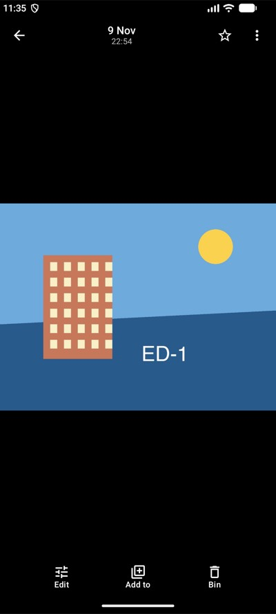 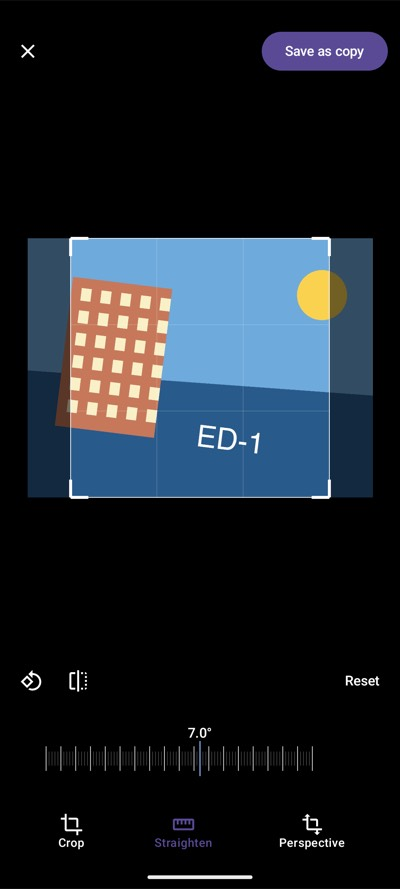 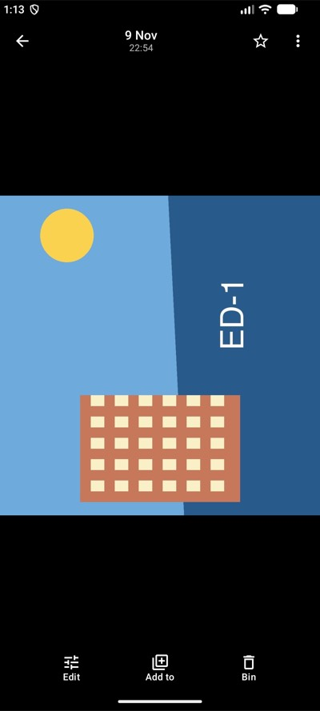  | 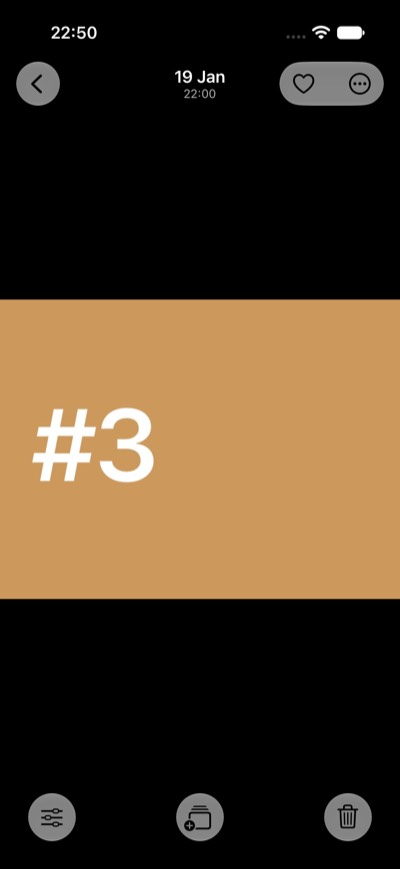 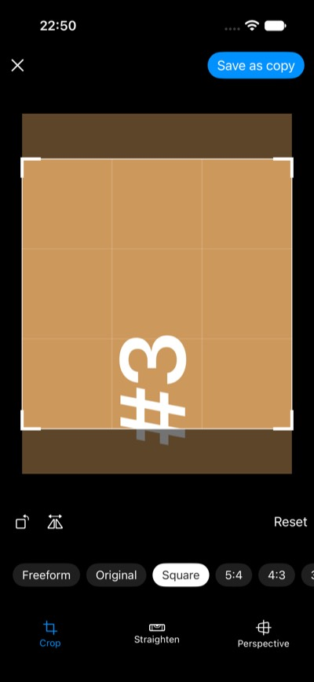 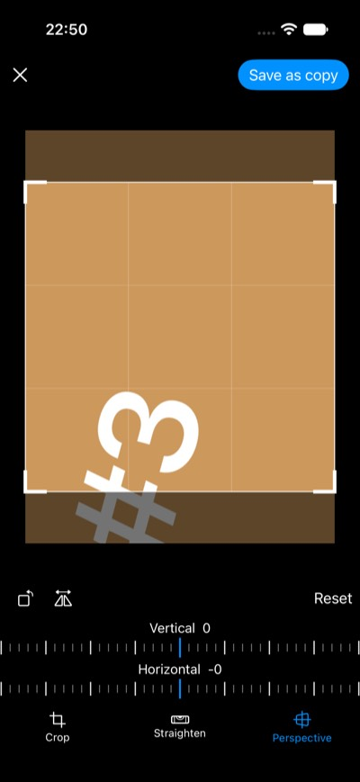 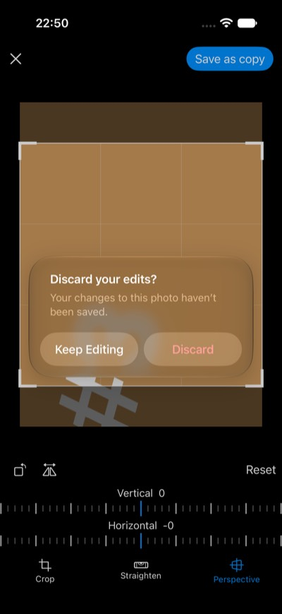 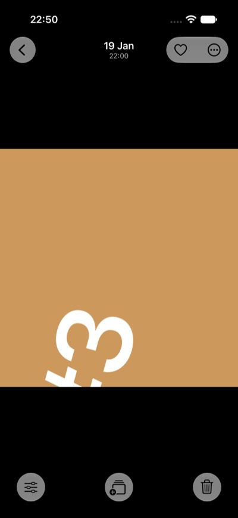 |

### 9.5 Not in this slice

- **Adjust and Filter** (ED-2), and non-destructive edits (ED-3).
- ⚠ **The iOS renderer has no pixel test** — `EditorUITests` drives it end to end on the simulator
  (§9.4) but asserts no pixels; a golden test belongs with ED-D8.
- Straighten/perspective *suggestions* (Vision), and a free four-corner perspective (Google's
  Perspective is a corner drag; ours is two keystone dials).
- Pinch-zoom inside the crop box.
- Hold-to-compare works on the picture and inside the box, not on its edges and corners — a still
  press there is the start of a handle drag.

### 9.6 ⚠ A save returns once the copy is on the device, not once the relay has it (2026-11-10)

The emulator's 55 s save (§9.4) was the upload op, not the editor. `UploadFile` writes the bytes,
then the row, then **journals the content push** (row → journal entry in one `NonCancellable` span),
and only then sends the bytes to the relay **inline** — and returns after that. The inline wait is
deliberate and documented at `emitFileContentOwned` (`SyncObserver`): every caller that reads
content straight after an upload, Drive's upload UI among them, relies on the op returning with
the bytes on the content plane. Desktop, iOS route-1 and Android (`uploadSourceFile`, the same
`UploadFileImplementation`) all wait the same way.

**The fix is in Photos, not the op** (no contract, wire or stored shape moves; no HR 9 bump):
`TenshuPhotosRepository` takes a `copyUploadScope` — the app's own scope (`PhotosModules`'
singleton; `PhotosLocalRuntime`'s `scope` on iOS) — runs the upload there, and returns as soon as
**either** the op answers **or** the copy's row is readable at its path (polled every 100 ms).
The op then finishes in that scope after the editor has closed; what it ends with is only logged.

- ⚠⚠ **Why the row is enough.** The bytes are written before the row; the row and the journal
  entry share one `NonCancellable` span, so a *cancel* cannot separate them, and a push that fails,
  times out or is interrupted after that stays journalled for the content drain — the path every
  other new local file takes offline.
  ⚠ **Not a process death.** Between the row and the journal entry sits `awaitEmitIdle`, bounded
  by `EMIT_IDLE_BOUND_MS` (30 s, normally milliseconds), and a process killed inside it leaves a
  row with local bytes and no push — nothing reads the unsent-content marker back to recover it.
  The gap predates this change, but an early return makes leaving inside it likelier, above all on
  iOS route-1, where the op runs in the Photos process itself.
- ⚠⚠ **A name in use is skipped *before* the upload,** and the check **fails closed**: the early
  return takes *any* row at the path as the copy, so an existing `-edited.jpg` must never get that
  far, and a read that cannot tell falls back to waiting for the op. The op's `AlreadyExistsError`
  stays as the backstop for a race. Refusals (`AlreadyExists`, quota) answer before any row is
  written, so they are still seen as failures.
- ⚠ **The scope must outlive the editor** — never `viewModelScope`. `null` (tests, any wiring
  without one) keeps the old wait. A scope torn down mid-save ends the save as a failure, not a
  spinner that never stops. And the editor's own cancellation no longer stops the upload: a save
  the user walked away from still makes its copy.
- ⚠ The still and motion thumbnail rungs are written and emitted only after the `File.Data` push
  inside the op, so they wait on the network too — and an op cancelled before then (the iOS graph
  torn down; on Android, if Control cancels a dead client's op) stores none, leaving them to
  `ThumbnailClassBackfill`. The viewer opens the copy from its local bytes regardless.

**What the user sees while the push is pending:** nothing different. The copy is in the feed and
the viewer at once, like any photo taken offline. Photos has no per-photo "not synced" indicator,
and none was added; Control's own sync state is where pending content shows.

**Tests:** `EditedCopySaveSystemTest` (real relay, real repository) holds every content `PUT` open,
saves, asserts the save returned **with a `PUT` still held**, the copy reads back on the device,
then releases the relay and asserts the paired device receives the copy's bytes.
`RealRepositoryReadTest.aSaveReturnsOnceTheCopyIsWritten_whileTheUploadOpIsStillPushing` (common,
so every lane) uses an upload that writes the copy and never returns, and pins the name-in-use skip;
`aSaveWhoseUploadScopeIsTornDownFails_ratherThanHanging` pins the teardown. Each was run once with
the piece it pins removed, and failed.

**On the emulator (2026-11-10, the storage-less one that took 55 s):** airplane mode on, a 12 MP
photo turned a quarter and saved — the copy's viewer was up **~2 s** after the tap (timed over
`uiautomator` polling), capture time kept, no failure logged. ⚠ This proves less than it seems: with
*no* network a `PUT` fails at once instead of hanging, so the 55 s case — a socket timeout on a
network that is up — is what `EditedCopySaveSystemTest` pins, not this run. And a storage-less
device never syncs content, so the "syncs once the network is back" half is the system test's too.

## 10. ED-2 as built — Adjust + Filter (2026-11-10)

The editor gains Google's tab row at the bottom, **Crop · Adjust · Filters** (`EditorTab`); the
rotate/mirror strip and *Reset* (now every tab's edits) stay on every tab, as Google's do. On the
Crop tab the picture is the whole frame under the crop box; on Adjust and Filters it is the cropped
result, as a save writes it.

- **Adjust** — the eleven sliders of §1.2/§2 in Google's order (`AdjustTool`): brightness, contrast,
  tone, white point, highlights, shadows, black point, saturation, warmth, tint, vignette. A row of
  chips (a changed slider shows its value); one picked opens the centred dial with its own *Reset*
  and *Done* (back to the row) — §1.2's control. Each slider is an integer `-100..100`.
- **Filters** — *Original* and eight looks of our own (ED-D5): **Daybreak, Harbour, Ember, Fjord,
  Linen, Moss, Slate, Graphite** — none of them Google's names (§1.2) or Apple's `CIPhotoEffect*`.
  A chosen look shows an intensity dial (`0..100`, double-tap = full); choosing it again keeps its
  intensity, another starts at full.
- ⚠ **No *Enhance*, on any platform.** The one honest candidate is Core Image's
  `autoAdjustmentFilters()`, and its output is a chain of Apple filters, not our eleven numbers — an
  iOS-only Enhance would bake an edit no other platform can re-open or draw (§3.3, ED-D8), and a
  missing feature elsewhere (§5's CR-D4 point). The honest version is a portable one that *sets our
  sliders* from the picture's histogram; not built. A tab with no tool behind it is not drawn
  (`control-cross-app-open.md` §5g.2), so there is no Auto tab either.

### 10.1 ⭐ One recipe, one order

`EditRecipe(transform, adjust, filter)` (`:photos-shared-logic`, beside `TransformEdit`) is what both
renderers draw and what ED-3 would store; `PhotoEditRenderer.render` takes it whole.
⚠⚠ **The order is defined once, in `EditRecipe`'s KDoc: transform, then adjust, then filter.**
Transform first because every later stage reads the transformed picture — the vignette is centred
on the crop the user chose, not the uncropped photograph (`PhotoEditRenderTest.theVignetteIsCentredOnTheCrop`).
Adjust before the filter so a look lands on the picture the user tuned, and its intensity fades
between two pictures that both carry the adjustments. On the Crop tab's uncropped preview the
vignette is centred on the crop box, where it will be once the crop applies (`ColorStage.vignette`).
The two colour stages do not commute; the parity tests' combined recipe is what makes a swapped
engine fail (mutation-checked: swapping the shader's two stages → max diff 32, red).
`isIdentity` covers the colour stages too, so a slider put back to 0 or a look at 0 arms neither the
save nor ✕'s question.

### 10.2 ⭐ One shader, three languages, one reference

- `EditShader.ADJUST_BODY` is the adjust math, written once: levels (black/white point) →
  brightness (a gamma, ends fixed) → contrast (a slope about mid-grey) → tone (an S-curve, ends fixed)
  → highlights/shadows (luminance-masked lifts) → saturation → warmth/tint → vignette (radial,
  elliptical to its frame). **Every value is sRGB-encoded**, the space Skia and Android hand a runtime
  shader; the sliders were tuned there.
- **AGSL and SkSL are the same text** (`EditShader.AGSL == SKSL`), which adds the look's LUT. **Core
  Image** gets `EditShader.CORE_IMAGE`: the same body with `float2/3/4` renamed to `vec2/3/4` — the
  only difference between the two — around a `destCoord()` colour kernel. ⚠ That is the **Core Image
  Kernel Language**, deprecated since iOS 12 but still in the iOS 26 SDK, and not Metal as ED-D8
  first said: CIKL is the one Core Image route that takes a source *string*, which is what lets the
  body be shared rather than hand-ported into a build-time `.ci.metal`. If Apple removes CIKL, the
  body is what moves.
- ⭐ `EditColor` is the same math in Kotlin, statement for statement — **the reference** every engine
  is pinned to, and what every Android save runs (§10.4). ⚠ Change the shader and the port in
  the same commit, or the parity tests fail.
- **iOS chain** (`EditColorPipeline`, Kotlin in `:tenshu-sdk-ios-photos`, called by
  `EditRendering.colour`): working-linear → `CILinearToSRGBToneCurve` → the kernel → `CIColorCube` of
  the look's lattice faded by `CIMix` → `CISRGBToneCurveToLinear`. In Kotlin so the code the golden
  test runs is the code the shell calls.

### 10.3 Looks as LUTs (ED-D5)

A look is plain arithmetic per colour (`FilterLooks`: curves, fade, split-toning, saturation), run
once per lattice point into a **33³ LUT quantised to 8 bits** (`EditColor.lut`, baked lazily per
process — no binary assets). 8 bits because that is what the Skia engines sample, so every engine
interpolates the very same lattice: Skia/AGSL read a `(33·33) × 33` image at texel centres with no
filtering (`setInputBuffer` on Android) and blend trilinearly in the shader; Core Image's
`CIColorCube` gets the same values as floats and interpolates them itself (within 1 level, §10.5). ⚠ `FilterLook.id` is what ED-3 would store — never
the label or ordinal — and **a look must not be retuned once used**: ED-3 would re-open old edits
with the new look. Add a look instead.

### 10.4 ⚠ Android: AGSL draws the preview, the CPU draws every save

- ⚠⚠ **No Android save can use AGSL, at any API level.** The export draws into a
  `Canvas(Bitmap)`, which is software-rendered, and software rendering throws on a `RuntimeShader`
  (*"Software rendering doesn't support RuntimeShader"* — found on the emulator: the first build's
  every save failed, while every JVM test was green). So Android's save colours on the CPU with the
  reference itself (`shaderOnBitmapCanvas = false`); desktop's Skia runs runtime effects on a raster
  canvas and saves through the shader. `PhotoEditRenderTest.androidsCpuSave_isDesktopsShaderSave`
  saves one recipe both ways on desktop. ⭐ It is fast enough: a **12 MP** save on the emulator took
  ~4 s from tap to the copy written (decode, transform, colour, encode, upload), the math split over
  four workers per band of rows, the pixel IO one band at a time (no second full-size bitmap).
- **Below API 33** (`minSdk` 24) AGSL does not exist at all. **Decided: every slider and look runs
  on the CPU there too** rather than hiding the four non-matrix sliders — the preview colours the
  transformed picture at its on-screen size, off the main thread on a pool of its own (it blocks
  per band; on `Dispatchers.Default` its workers could starve their own children), latest wins and a
  superseded pass stops at its next band. While it computes the last frame drawn **for the same
  plan** stays up; with none, nothing is drawn — never the picture with the sliders silently missing,
  nor the Crop tab's uncropped frame stretched into the cropped one. It is the same
  function as the reference, so it is pinned by construction
  (`EditShaderParityTest.theCpuPathIsTheReference` runs it through real bitmap pixel IO, exact).
  `drawEdited` returns `false` when it could not apply the colour, and the save then owes the CPU
  pass; the preview decides up front (no shader → the CPU frame). ⚠ The < 33 preview is not
  device-verified: no such emulator image here (disk). The CPU *save* is — it is every Android save.

- **Colour first, then onto black.** JPEG has no alpha, so a save flattens the picture onto black —
  on the CPU path and on iOS only *after* the colour stages, as the shader does. The plan never
  leaves an empty wedge (straighten and keystone always scale to cover, §9.1), so what this guards
  is the half-covered pixels along a turned edge, which the sliders would otherwise tint. Found in
  review.
- The preview keeps one shader per (picture, plan, recipe) across redraws, so a redraw does not
  compile AGSL again; a dial tick still builds one.

### 10.5 What the tests pin

- **Golden parity (ED-D8).** `EditParityFixtures` (in main, because two modules' tests use it): a
  96×64 picture of every hue at every lightness over a grey ramp, 33 recipes (each slider ±70,
  each look, a look at 40, and *everything* at once with an off-centre vignette), and the **stated
  tolerance: no channel more than 6 levels from the reference, mean under 1.0.**
  - SkSL (desktop) — `EditShaderParityTest`: **max 1 level, mean ≤ 0.02** on every recipe.
  - Core Image — `PhotosIosTests/EditParityTests` (hosted XCTest, iPhone 17e simulator, iOS 26):
    **max 1 level** on every recipe; the sliders alone are **exact** (max 0), the looks mean ≤ 0.05.
  - AGSL — the same text as SkSL (`EditColorTest.oneShaderText_twoDialects`); its runtime was
    checked on the emulator (§10.6), not in a test: no JVM test can run AGSL, and the repo has no
    instrumented runner.
  - ⚠ The Core Image test is an **app-hosted XCTest bundle** (`PhotosIosTests`, new in
    `project.yml`, in the `PhotosIos-UITests` scheme), not a Kotlin iOS test: a K/N simulator test
    process has no Metal device, and `CIContext` there is nil — every pixel reads 0.
- `EditColorTest` (commonTest): the identity is exact, each slider moves the way its name says and
  keeps what it should (brightness keeps black and white, highlights leave shadows), the vignette
  follows its frame, lattice points are exact, mono looks are grey, intensity is a linear fade, and
  adjust-then-filter differs visibly from the other order.
- `PhotoEditorViewModelTest`: a slider alone is an edit and its reset is not; *Done* and tab switches;
  a look starts full, keeps its intensity, *Original* removes it; the save hands the renderer the
  whole recipe; *Reset* clears every tab.
- `PhotoEditorScreenTest.adjustAndFilter_reachTheSavedCopy` — through the UI and the real Compose
  renderer: the dial drives saturation down, *Done* returns, *Slate* is chosen, and the saved copy of
  a red-over-blue picture is **grey**. `PhotoEditRenderTest.theVignetteIsCentredOnTheCrop`.
- iOS `EditorUITests.testAdjustAndFilter_thenSave`: Adjust → Warmth dial → *Done* → Filters → Ember →
  intensity shown → save → the copy in a viewer.

### 10.6 Verified on devices (2026-11-10)

- **Android** (`Medium_Phone` emulator, API 36, real Control): Crop · Adjust · Filters; Brightness
  +43 and *Ember* preview live through AGSL and save; the copy opens in its own viewer. ⭐ **AGSL
  against the reference, on the device:** a 4000×3000 photograph with Brightness +43 and Ember —
  the on-screen AGSL preview and the saved copy (the CPU reference) sampled at five flat spots
  (the square, the sun, sky, ground, a gradient) differ by **at most 1 level**. The first build
  failed every save (§10.4), found here.
- **iOS** (iPhone 17e simulator): `EditorUITests` — the two ED-1 tests and the new
  `testAdjustAndFilter_thenSave` — pass, as does `EditParityTests`.
- **Desktop**: by the Compose UI test (`PhotoEditorScreenTest`) and the renderer tests on the real
  Skia renderer; the packaged desktop app was not launched (it needs a running Control).

| | |
|---|---|
| 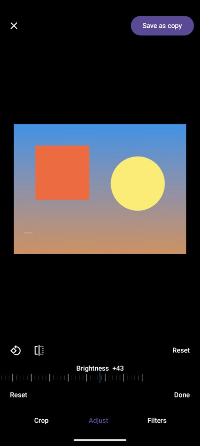 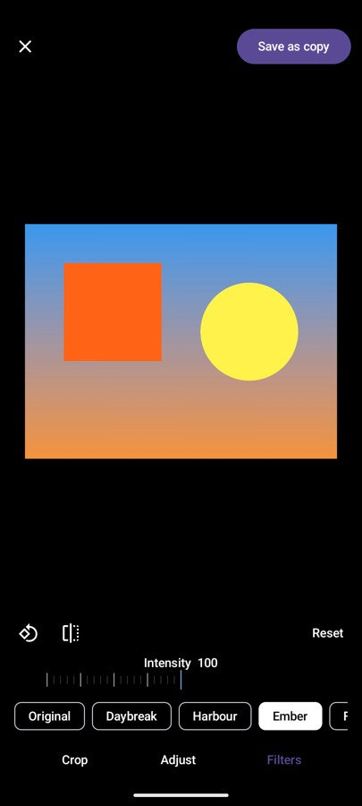 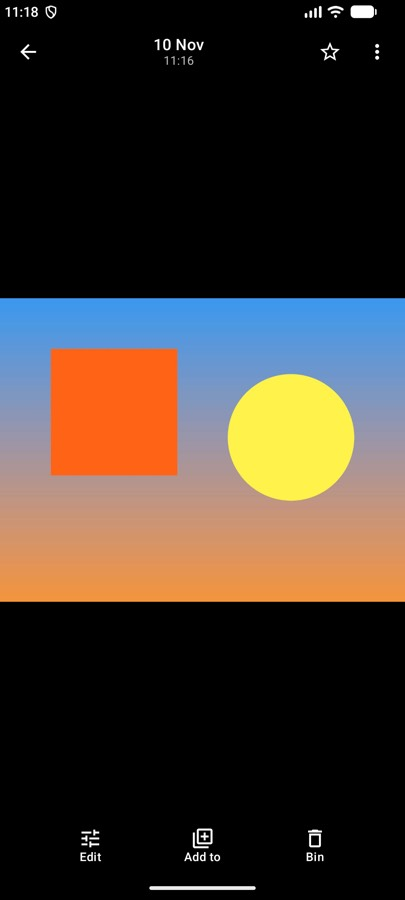 | 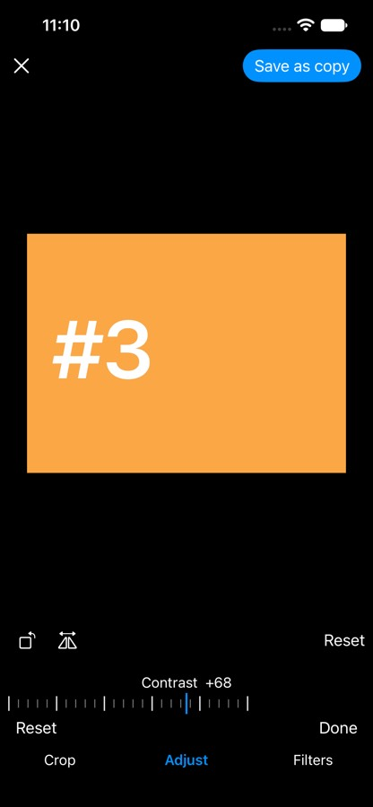 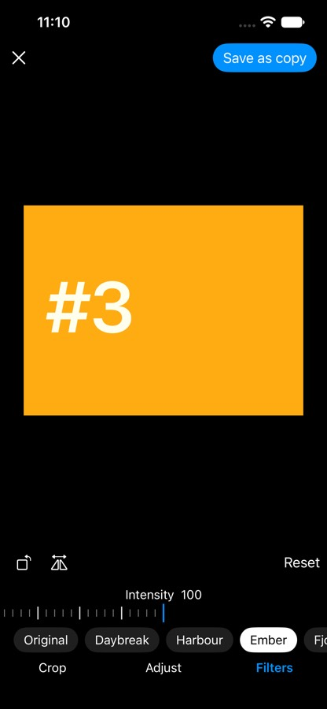 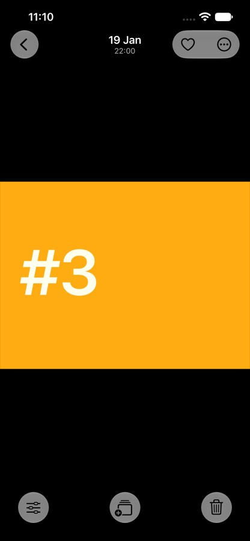 |

### 10.7 Not in this slice

- *Enhance* (§10, above) and Google's model tools (Portrait Light, Skin/Blue tone, Ultra HDR).
- Filter **thumbnails** — the looks are name chips, not previews of the photograph.
- ED-3 (`PhotoEdit`): the recipe is ready to store, nothing stores it.
- An automated AGSL golden test (needs an instrumented test runner this repo does not have) and an
  API < 33 device run of the CPU preview (no such emulator image here).
- ⚠ The iOS renderer's **transform** still has no pixel test (§9.5); `EditParityTests` covers its
  colour stages.

## 11. ED-4 as built — Markup (2026-11-10)

The tab row is now Google's **Crop · Adjust · Markup · Filters** (Markup before Filters, where §1.2
has it). Markup's tools are **Pen · Highlighter · Redact · Text**: six colours (`InkColor`) and three
widths (`InkWidth`), each inking tool keeping its own choice (`MarkupBrushes`); the highlighter is
the pen at 40 % opacity and broader; Redact is a dragged box, always black; Text is a tap that opens a
field, a tap on a label that edits it (with *Delete*), and a drag that moves it. **Undo / Redo** sit
in the panel. The strip (rotate, mirror, *Reset*) stays, as on every tab. ED-D1, ED-D2, ED-D3 and
ED-D6 hold unchanged: markup is pixel math, the copy is baked, and ✕ asks over unsaved ink.

### 11.1 ⚠⚠ Ink lives in the source frame

**Every point is stored in the source frame**, normalised (`NormPoint`) — ED-1's rule for the crop
(§9.1), and for the same reason: a stroke is ink *on the photograph's pixels*, so a rotate, mirror,
crop, straighten or keystone made **afterwards** moves it with the picture by construction, and
nothing ever re-maps it (`MarkupTest.aStroke_staysOnTheSamePixelsThrough…` asserts the stored item is
unchanged by four later transforms and still lands on its source pixels at two decode sizes;
`MarkupRenderTest.aStroke_landsOnTheSameSourcePixels_afterALaterRotateAndCrop` checks it in a
saved copy). The alternative — store in the view and re-map on every transform — makes the transform
order matter, which is what ED-1 set out to avoid.

- The shells report a finger **normalised to the picture as shown** (the cropped result, as on
  Adjust); `PhotoEditorViewModel.markupDown/Move/Up` take it to the source through the inverse of
  the plan (`RenderPlan.unmap`, `MarkupView`). The shells never see a source point.
- **A width is chosen on screen, stored on the source.** A width is a fraction of the shown picture's
  long edge, converted at the first point by the plan's local scale (`RenderPlan.localScale`) to a
  fraction of the source's long edge. So it is drawn exactly as picked, and a later crop thickens it
  with the picture it is on.
- ⚠ **A label's *anchor* follows the picture; its text stays upright.** `LabelOp` carries no angle:
  a label turned with a quarter turn, or mirrored, would read sideways or backwards, and a label is
  for reading. Its size scales with the picture like a stroke's width.
- ⚠ Under a **keystone** a stroke's centreline is exact (every point goes through the projective
  plan) but its width is constant along the stroke rather than warped — a pen line does not taper
  into the distance. Everywhere else (turn, mirror, straighten, crop) the plan is a similarity and
  the scene is exact.

### 11.2 ⭐ One scene, two drawers; markup draws last

`EditRecipe(transform, adjust, filter, markup)`: ⚠⚠ **markup is the last stage**, drawn over the
coloured picture, so no slider or look recolours the ink and the vignette does not darken it
(`MarkupRenderTest.inkIsDrawnAfterTheColourStages_…`: a red stroke under *Slate* and a full
vignette is the pen's red in the corner; the photo under it is grey).

`MarkupRender.scene(markup, plan, w, h)` (`:photos-shared-logic`) reduces the markup to **draw
operations in output pixels**: `StrokeOp` (a polyline, width, colour, alpha — round caps and joins),
`FillOp` (a polygon) and `LabelOp` (text, centre, size). Each shell only draws ops — Compose's
`drawMarkup` (`MarkupDrawing.kt`) on Android and desktop, `MarkupDrawing.swift` (Core Graphics) on
iOS — and **the preview and the save call the same drawer with the same scene**, over the preview's
plan or the full-size one. A highlighter is **one path with its alpha in the paint**, so a stroke
crossing itself is one coverage, not darker where it overlaps, on both.

- iOS keeps Core Image off the per-point path: the preview's `CIImage` redraws on a transform,
  colour or tab change only, and the ink is drawn by the SwiftUI canvas over it, live.
- `isIdentity` includes the markup, so ink alone arms *Save* and ✕'s question, and undoing all of it
  disarms both.

### 11.3 ⚠⚠ Redact is a privacy tool, and is built as one

The saved copy must hold **no trace** of what was under a box — not a black layer over intact
pixels. Two facts decide the construction:

- **Drawing the box on the output is not enough.** The transform samples the source with a filter,
  so an output pixel just outside a box drawn on the output blends source pixels from inside it.
  Measured: with the source fill removed, the box still *looks* black and
  `aRedactedCopy_isBlackUnderTheBox` stays green, but the copies of two sources that differ only
  under the box are **different bytes** — the edge leaks.
- So ⚠⚠ **the save destroys the redacted pixels in the source raster before anything reads it**
  (`MarkupRender.redactionsInSource` → `redacted` on Compose, `MarkupDrawing.redacted` on iOS):
  filled black with **no anti-aliasing**, plus a `SOURCE_FILL_PAD` (2 px) outline so a pixel the edge
  merely touches goes too (on iOS in a half-float extended-linear context, so a box does not cost a
P3 photo its gamut). Then the box is drawn **again** on the output, after the colour stages, so
  it stays pure black under any slider or look (the source fill alone would be lifted grey by
  *Linen*'s fade or a black point). JPEG cannot reintroduce anything: the encoder never sees an
  original pixel from inside the box.

⭐ **The proof is byte identity.** `MarkupParityFixtures.redactSource(seed, secret)` builds two
noise sources that differ in **every pixel the box so much as touches** (centre inside, or crossed by
an edge), and nowhere else; a save of each through a recipe that resamples everything (turn,
straighten, keystone, crop) with sliders and a look on top must be **the same bytes** — and the same
recipe without the box must not be, or the test proves nothing. Pinned on desktop
(`MarkupRenderTest.aRedactedCopy_isTheSameBytes_…`, on the shader save **and** Android's CPU save) and
on iOS through `EditRendering.render` itself (`PhotosIosTests/MarkupParityTests`), and on desktop
once more with the decode **downscaling** the original, as a phone photo over `MAX_DECODE_EDGE` is. A second test
decodes each copy and asserts every pixel ≥ 4 source px inside the box is black (≤ 12 levels).

⚠⚠ **What a redaction protects is the copy.** The photograph being edited is never written (ED-D1),
so its pixels are still in the library, and anyone the *original* is shared with sees them.
The UI says *"blacked out in the saved copy"*, and nothing more is claimed. ⚠ **ED-3 must keep
this**: a non-destructive `PhotoEdit` that re-rendered a redaction from the original plus the recipe
— or that synced the recipe to a device the rendition went to without the original — would be a
redaction a reader can undo. A redacted rendition must be baked (ED-D2) and handed out *as* the photo.

### 11.4 Text

One line, bold, in **each platform's own font** (Android `Typeface.DEFAULT_BOLD`, Skia's default
bold on desktop, San Francisco bold on iOS), centred on its anchor. The fonts differ, so labels are
**not** in the render parity (§11.5), and that is by the bake rule: a saved copy carries its pixels
(ED-D2), and no device redraws another's label. Placement and size are shared and pinned
(`MarkupTest.aLabel_followsItsSpot_butIsDrawnUpright`). A label being typed is a `LabelDraft`, not a
recipe item: a new one joins only when committed with text; blank text deletes an existing one. The
view model's label hit test **estimates** the text's box from its length (the shells measure text;
the model does not), generously.

### 11.5 What the tests pin

- **Model** (`MarkupTest`, commonTest, every lane): the source-frame rule both ways (ink drawn before
  a transform, and after one, lands where the finger was); widths as shown and thickened by a crop;
  highlighter translucency and per-tool brushes; a redact tap draws nothing and leaves no undo; text
  placed, edited, moved (one undo for the whole drag) and deleted; a label field open blocks drawing;
  undo/redo stepping, a new stroke ending the redo branch, undo touching markup only; *Reset*
  clearing markup and its history; gestures only on the Markup tab; the save getting the markup, and
  markup frozen while saving.
- **Render parity** (`MarkupParityFixtures`, in main for `EditParityFixtures`' reason): a straightened
  160×120 scene of a curved pen, two highlighters, a thin pen and a redaction quad over a grey ramp,
  against a plain-Kotlin **coverage rasteriser**. ⚠⚠ **The stated tolerance: mean ≤ 1.5 levels, and at
  most 2 % of pixels more than 48 levels off** — anti-aliasing differs along every edge, so the far
  budget is for edge pixels, which a misplaced, mis-sized, mis-coloured or opaque stroke exceeds by
  far (the Compose test checks that the same scene with opaque highlighters **fails**).
  - Compose (desktop Skia): **mean 0.29, 0 % far.**
  - Core Graphics (iPhone 17e simulator, `PhotosIosTests/MarkupParityTests`): **mean 0.15, 0 % far.**
  - Android draws through the same Compose calls on its own Skia; not run in a test (no instrumented
    runner — the AGSL gap of §10.5), seen on the emulator (§11.6).
- **Redaction**: §11.3's two tests, desktop (both save paths) and iOS.
- **Stage order and survival**: `MarkupRenderTest.inkIsDrawnAfterTheColourStages_…` and
  `aStroke_landsOnTheSameSourcePixels_afterALaterRotateAndCrop`.
- **Through the UI**: `PhotoEditorScreenTest.markup_aPenStrokeReachesTheSavedCopy_andUndoIsOneTap`
  (green on a grey photo comes back green in the saved copy; undo/redo arm and disarm *Save*) and
  `markup_textIsPlacedEditedAndDeleted_throughItsField`; iOS
  `EditorUITests.testMarkup_penRedactAndText_thenSave`.

### 11.6 Verified on devices (2026-11-10)

- **Android** (`Medium_Phone` emulator, API 36, real Control): a 1600 px photograph imported through
  Drive's *Upload → File*; on Markup a thick red pen stroke, a yellow highlighter, a redaction box and
  a *Tenshu* label (typed in the field). Then, **after** the markup, *Slate* and a quarter turn: the
  photograph goes black-and-white while the ink keeps its colours, the strokes and the box turn with
  the picture, and the label stays level (§11.1, §11.2). *Save as copy* opened the copy in its own
  viewer with all of it baked. `android-smoke.sh`: every app launched and stayed up, every schema
  matched source, no IPC failures — ⚠ its one red was the **Contacts canary** refusing its session
  (`clientRequires=2` against master's contact-service v1): the copy on that emulator came from
  another branch, the foreign-install case `docs/testing.md` §6 describes, not this change.
- **iOS** (iPhone 17e simulator, iOS 26): `EditorUITests.testMarkup_penRedactAndText_thenSave` —
  pen (green, thick), undo/redo arming and disarming *Save*, a highlighter, a redaction box, a typed
  label, save, the copy in a viewer — passes with the three earlier editor tests, and
  `PhotosIosTests` (`MarkupParityTests` ×3, `EditParityTests` ×2) pass.
- **Desktop**: by the Compose UI tests and the real Skia renderer (§11.5); the packaged app was not
  launched (it needs a running Control), as in ED-2.

| | |
|---|---|
| 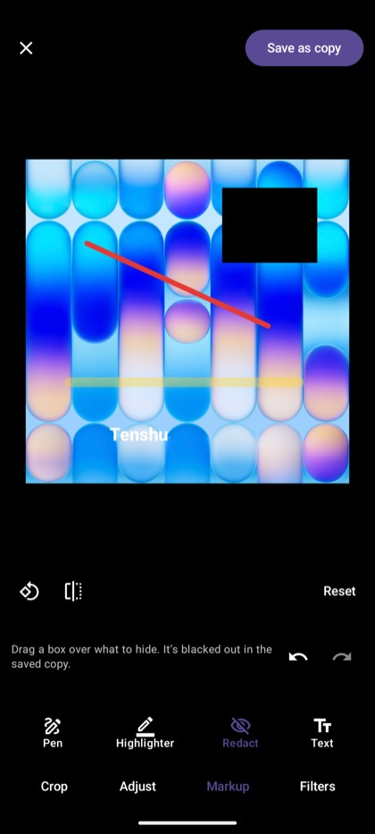 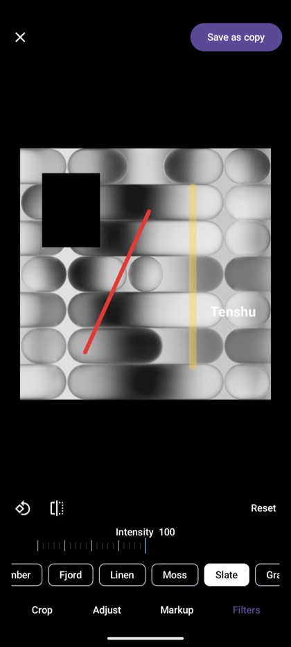 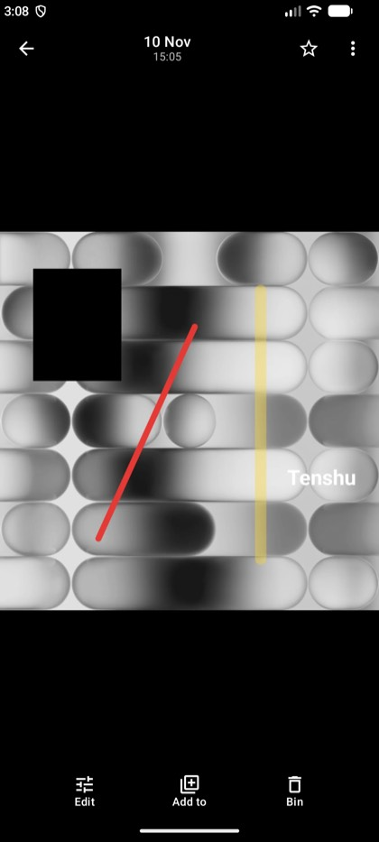 | 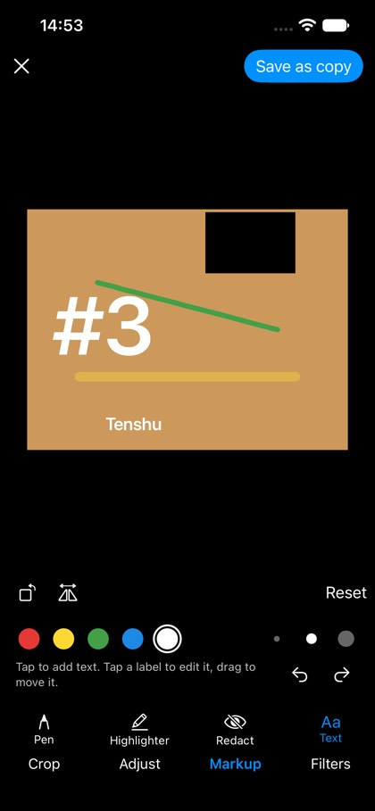 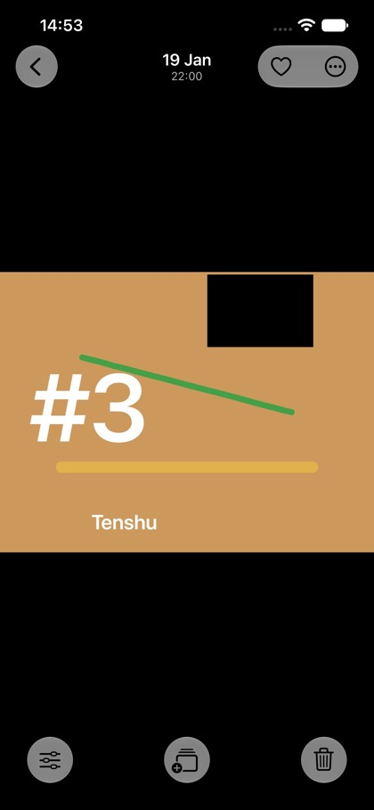 |

### 11.7 Not in this slice

- ⚠ **PencilKit, deliberately.** It would give iOS a better pen (pressure, Apple Pencil) — as a
  `PKDrawing` the shared model cannot read, draw on Android, undo with the other tabs or store for
  ED-3. One model drawn by each shell is the ED-1 rule; pressure can join `InkStroke` later as a
  per-point width, on every platform at once.
- Shapes and arrows (Google's markup has neither), multi-line or rotated labels, a font choice.
- Pinch-zoom while drawing — fine detail is drawn by cropping first, then marking up.
- Pixelate as a redaction style. ⚠ Solid black is the only style on purpose: a mosaic keeps each
  block's average, which is information, and a heavy blur is partly invertible.
- An eraser; undo and delete cover it.

## 12. ED-3 — the non-destructive edit (`PhotoEdit`)

*Design settled 2026-11-10, before code; the as-built notes follow it (§12.8 on).* §3.2 (B) is
built, in one slice (the feed half turned out small enough not to split, §12.5): the photograph's bytes and its `contentId` never move, and a synced **`PhotoEdit`** row in
`:photo-service`, keyed on that `contentId` the way `PhotoFlags` is, says how the photo is edited.
The feed, the viewer and the album covers show the edit; *Revert* deletes it; *Edit* on an edited
photo opens the original with the stored recipe. Albums, favourites, hidden and trash records are
keyed on `contentId` and are therefore untouched by construction — the reason §3.1 bans overwrite.

### 12.1 The row

`PhotoEdit` (`tenshu/photo/edit`, `Syncable(Eager)`, one row per edited photo, absent = unedited):

| Field | What |
|---|---|
| `contentId` | the **original's** `File.ContentId` — the row key |
| `recipe` | the `EditRecipe`, as versioned JSON (`EditRecipeCodec`, §12.2) |
| `renditionPath` | where the baked rendition lives (§12.3) |
| `redacted` | the recipe holds a redaction — readable without decoding the recipe |
| `editedAt` | when it was saved |

Two ops, the `SetPhotoFlags` / `ClearTrashedPhoto` pair's shape: `SetPhotoEdit` (an upsert) and
`ClearPhotoEdit` (a delete). Like `RecordTrashedPhoto`, ⚠ **neither touches a file** — the app
uploads and deletes the rendition either side of them, so `:photo-service` still cannot touch a file.
A last-writer-wins row is the right merge: an edit is one statement, and two devices editing the same
photo concurrently end on one of the two edits, whole, never a blend. A *Revert* racing a peer's
*Save* can lose to it (resurrection, `SetPhotoFlags`' KDoc); the peer's edit is then what shows,
which is a state the user can act on.

**HR #9:** `PhotoService` v1 → **v2**, with an empty `schemaMigration(PhotoService.ID, fromVersion = 1)`
— additive, a new type and a new relation, no existing field moves (PH-5's v6 → v7 precedent). ⚠ It
is the **first post-release service bump**: a bump with no step wipes the store, and
`ServiceMigrationChainsReachTheirVersionTest` is what says so. `:photo-service-common` is already in
`:system-test-utils`, so `SchemaShapeBaselineEnforcementTest` sees the new composite and two ops.

### 12.2 ⚠ ED-D9 — the recipe is versioned JSON in one string field, not a schema type

HR #4 asks for the schema DSL when a *cross-platform* type crosses the wire. The recipe does cross
it, but it is **opaque to everything except the Photos editor**: no proxy, op or other app reads
inside it, and nothing merges it field by field (§12.1). Spelling it as composites — a transform, 11
sliders, a look, and a sealed list of strokes / boxes / labels with point lists — would put a
positional reshape (HR #9, a bump of `:photo-service` and a lockstep move of every client) behind
every future editor tool, for a structure only one app ever opens. So:

- `recipe` is a `TString` holding `{"v":1, …}`. ⚠ Enums are stored by their **stable ids** — 
  `FilterLook.id`, `InkColor.id`, `AspectPreset.name` — **never a label or an ordinal** (§10.3).
- ⚠⚠ **A recipe this build cannot read is not an error; it only blocks re-editing.** A newer
  editor's `"v":2` decodes to *unreadable*: the photo still **shows** its rendition (which is the
  whole point of ED-D2), and *Edit* opens the original with a notice that the edit came from a newer
  version, offering *Revert* — never a silent drop of the newer edit's parts.
- A new tool is a codec change with a version bump of `v`, not of the service.

### 12.3 ⚠⚠ ED-D10 — the rendition is a file under `/Trash/.edits/`

The rendition must be **its own content** with thumbnails minted on the editing device "by the
normal upload pipeline" (§3.3) — so it is a `File`, uploaded with `uploadFile` / `uploadSourceFile`
exactly as a *Save as copy* is, and every device reads its thumbnails with the same `GetPreview`
ladder as any photograph. The question is **where**, because a file in the realm is a file every
photo reader sees — and a rendition read as a photograph is a duplicate in the feed, a second photo
in Timeline's moments (`photosCapturedBetween`), a second hit in search and Mia, a second row in the
indexer's vectors and faces. Measured, the readers are **eight**: the Photos feed and its count and
capture times, `PhotosCapturedBetween`, `PhotosNear`, `ImageLibraryWalk` (the indexer), `LivePhotoPaths`,
Mia's existence check, `:app-ingest`'s realm reads and the web SDK.

| Where | Cost |
|---|---|
| a new root (`/.edits`) | every one of the eight needs a new exclusion; in a chain that is a new derived `File` property (the DSL has no negation, `File.Trashed`'s KDoc), i.e. a **`:file-service` bump** that fences **every** app, for a Photos concept in the platform's most central schema |
| a non-image name (`x.jpg.rendition`) | category `Other` excludes it everywhere — and declines it in the thumbnail minters, which decide by name; no thumbnails |
| **under `/Trash/`** | ⭐ **every reader already excludes it**, in the chain (`notTrashed()`) and in the proxies (`isTrashedPath`) — zero new predicates, zero `:file-service` change |

**Decided: `/Trash/.edits/<contentId>-<ms>-<random>.jpg`, a name never used twice** (§12.9) (`EDIT_RENDITIONS_ROOT`, beside
`TRASH_ROOT` in `:file-service`, which owns the path namespace). ⚠ What it costs, and the guards:

- ⚠⚠ **`/Trash` is no longer only deleted files.** Nothing empties it wholesale today — Photos'
  *Delete forever* and *Empty trash* act on `TrashedPhoto` records, one path each, and no sweep or
  timer purges the folder. ⚠⚠ **A future auto-empty of `/Trash` must skip `EDIT_RENDITIONS_ROOT`**
  (`isEditRenditionPath`), or it deletes every edit's picture; the constant's KDoc says so where the
  next author will look.
- Drive lists the folder, as it lists `/Trash` itself (`TrashRoot.kt`: one realm, one trash). A user
  who deletes a rendition there gets §12.5's *missing rendition* state, not a broken photo.
- Photos' Trash screen reads records, not the folder, so renditions never appear there.

### 12.4 ⚠⚠ The display rule — ED-D2 and §11.3 as one sentence

> **A photo with a `PhotoEdit` row is shown by its rendition, or not at all.**

- No device re-renders an edit for display (ED-D2). The recipe is read **only** by the editor, to
  re-open the edit.
- ⚠⚠ **A device that has the row but not the rendition shows a placeholder, never the original.**
  This is §11.3's case: the row can sync before the rendition's bytes, and the rendition can be gone
  (deleted in Drive, a save that died after the row). Falling back to the original would show a
  redacted photo un-redacted, so nothing falls back — for *every* edit, not only redacted ones:
  one rule is testable, and "redacted" is a property a reader could get wrong.
- The original is still the library's, and still where §11.3 left it: Drive shows the file, *Edit*
  opens it, *Revert* restores it. What the rule protects is every surface that **hands out** the
  photo — the feed, the viewer, a share — which is why a share, when Share ships (ED-D7), must
  hand out the rendition by default and the original only as an explicit choice, warned when
  `redacted`. ⚠ Photos has no Share or Download today; the rule is recorded here so it is the one
  they are built to (`Photo.renditionPath` is what they read).
- **Save order: row first, then the rendition upload** (and, on a re-edit, the old rendition
  deleted last). The row arriving first means a peer that sees the rendition's file has, in sync
  order, already seen the row — so the window in which a peer could map the rendition's file without
  knowing it is one closes, and the window that stays open (row, no rendition) is the placeholder
  above. A failed upload restores the row as it was (or clears it), so a refused save leaves nothing.
- **Revert order: row first, then the rendition's file** — the row is what decides display, so the
  photo shows its original the moment the row is gone, and a crash between leaves only an orphaned
  rendition (quota, §12.6), never a photo pointing at nothing.

### 12.5 The feed prefers the rendition — one small read per feed generation, not one per page

§3.3 feared *a read across `:photo-service` per page*. It is not needed: the edits are a short list
(one row per *edited* photo, like favourites), so the repository holds them as an **index**
(`contentId → rendition`) loaded **before the feed's first page** and kept current by observing the
list, and every `Photo` the repository maps carries `renditionPath` from it. Tiles, the viewer and
album covers ask for `Photo.previewPath` (`renditionPath ?: path`), so no shell learns what an edit
is. ⚠ Measured in §12.9, not guessed.

- ⚠⚠ **The index loads before the first page is mapped.** A first page mapped against an empty index
  would show every edited photo's original until the next reload — on a cold start, un-redacted.
- ⚠ The rendition's thumbnails come from its own upload (the editing device mints them, §12.3),
  through the same ladder and pull a photo's do; the viewer's hero rung likewise.
- **Missing rendition:** a tile whose rendition cannot be read shows the empty placeholder (and keeps
  asking, §41.2's retry), and the viewer page says what it says for any photo with no rung yet —
  *"This photo hasn't been downloaded to this device yet"* — with *Revert to original* in ⋯.

### 12.6 Quota

The rendition is a file, so its bytes and its thumbnail rungs count against the realm's storage
exactly like a *Save as copy* — the honest answer, and the one the retention model already accounts
(`retention-quota-model.md` §2: it is durable content). A refused upload (over quota) fails the save
as *Couldn't save*, and §12.4's rollback leaves the row as it was. A re-edit deletes the superseded
rendition, so an edit costs one rendition however often it is re-saved; a revert deletes it.
⚠ A crash between a row change and its file delete leaves an orphaned rendition (counted, not
shown); nothing sweeps them yet (§12.12).

### 12.7 ED-D11 — *Save* is primary, *Save as copy* secondary

The editor's top-bar action becomes **Save** (the non-destructive edit), with **Save as copy** in its
⋯ menu — Google's arrangement for a backed-up photo (§6 Q1). Both stay: a copy is still the way to
keep two versions side by side, or to get a file Drive can hand to another app with the edit in it.
On an edited photo *Save* replaces the edit; putting every tool back to nothing and saving is a
*Revert*. *Revert to original* is in the viewer's ⋯ menu on an edited photo, behind a confirm (the
recipe goes with the row, so a revert cannot be undone).

### 12.8 As built (2026-11-10)

- **`:photo-service` v2**: `PhotoEdit` + `photoEdits` + `SetPhotoEdit` / `ClearPhotoEdit`, the empty
  v1→v2 step, both baselines regenerated (additions and version churn only; no field moved). Photos'
  bundled manifest declares the two ops (*"Save edits to photos, keeping the originals"*, *"Revert
  edited photos to their originals"*).
- **`EditRecipeCodec`** (`:photos-shared-logic`): `{"v":1,…}`, defaults omitted (an identity recipe
  is `{"v":1}`), ⚠ `v` itself has no default — `encodeDefaults = false` silently dropped it in the
  first build, and every recipe read back *unreadable*; the codec test caught it.
- **`TenshuPhotosRepository`**: the edit index (§12.5), joined into every `Photo` it maps
  (`toPhotoOrNull`, `IndexedContent.toPhoto`, album covers); `saveEdit` / `revertEdit` /
  `photoEdit` in §12.4's order; a permanent delete (`deleteForever`, `deletePermanently`) drops the
  edit and its rendition. The rendition is uploaded through the same `EditedCopyUpload` as a copy —
  so on Android through a cache file and `uploadSourceFile` (§9.2) — with §9.6's early return.
- **Editor**: `PhotoEditorUiState.initialRecipe` is the stored recipe, read **before** the editor
  turns ready; `dirty` compares by `EditRecipe.drawsLike` (a look at 0, or the aspect lock alone, is
  not a change — `==` would have armed ✕ over nothing). `save()` (identity → `revertEdit`, no render),
  `saveAsCopy()` unchanged; `SavedAs` tells the shells which happened. *Save* closes onto the same
  viewer (the lists holding the photo are patched); *Save as copy* still opens the copy's viewer.
- **Shells**: every tile, hero page and cover asks for `Photo.previewPath` (Compose `PhotoTile`,
  `PhotoViewerScreen`, album covers; SwiftUI `PhotoTileView`, `HeroImageView`). iOS's viewer page
  prefers the view model's photo over the list's, so a save or revert redraws a `Fixed` snapshot.

### 12.9 ⚠⚠ Found while building

- **⚠⚠ `:photo-service` deletes never left the device.** `SyncObserver.onDataDeleted` emits no
  tombstone — a delete op must (`DeleteWorkout`'s KDoc) — and none of the service's deletes did. A
  *Revert* reached no other device, which would then show an edit whose rendition the reverting
  device had deleted: a placeholder for good. `PhotoEditSyncSystemTest` (two devices, real relay)
  failed on exactly that; `photoServiceProxyImplementationFactory` now takes the `TombstoneEmitter`
  (wired on Android, desktop and iOS Control) and `ClearPhotoEdit` emits one. `DeleteAlbum` (album
  and every cascaded entry), `RemoveFromAlbum` and `ClearTrashedPhoto` — the same bug, older than
  this doc — now emit through the same emitter, each pinned by `PhotoDeleteSyncSystemTest` (two
  devices, real relay, red with its emit deleted), which also re-creates each key afterwards: the
  same photo back into the same album or the trash must not stay held down by the tombstone.
- **⚠⚠ The first post-release bump was not gated.** `SchemaMigrationRegistry.verify` judges a chain
  only for a service that registered a step, so `:photo-service` at v2 with **no** step passed
  `ServiceMigrationChainsReachTheirVersionTest` — and its derived floor would have wiped every v1
  store. Measured by deleting the step: green. The test now also asserts every service above v1 has
  a chain (`aServiceAboveTheBaseline_registersAChainAtAll`), and was red without the step. ⚠ The
  runtime `verify()` has the same blind spot (§12.12).
- **The edit index, measured** (`EditIndexReadBenchmarkTest`, opt-in, JVM, production store pair,
  2,000-photo library, no IPC): **0.03 ms** with no edits, **0.4 ms** with 100, **1.6 ms** with
  1,000 — against a first feed page of 60 at **15–23 ms**. One read per feed generation, not per
  page. ⚠ Over IPC each row is ~120 bytes (a content id and a path), so the index fits one Binder
  reply up to several thousand edits; a library edited past that needs the read paged.

### 12.10 What the tests pin

- `EditRecipeCodecTest` (commonTest): every tool round-trips to an **equal** recipe; enums by id
  (`"ember"`, `"red"`, `"R4_3"`, never a label); a newer `v`, an unknown look, kind or key, and junk
  are all *unreadable*.
- `RealRepositoryReadTest` (real ops, in process): a saved edit keeps the path and `contentId`, the
  favourite and the album entry; the feed, `feedCaptureTimes`, `allPhotosRead`, the album and its
  cover all show the rendition and **never list it as a photo**; a relaunched repository maps the
  edit on its first page; a re-edit deletes the superseded rendition; a revert (and saving the
  identity) clears the row and the file; ⚠ a refused rendition upload restores the previous edit,
  or none; a permanent delete drops the edit.
- `PhotoEditorViewModelTest`: *Save* records an edit, not a copy; an edited photo opens on its recipe
  and is not dirty; reset + save reverts without rendering; a newer recipe is said.
- `PhotoEditorScreenTest`: *Save as copy* through ⋯; the viewer asks for the **rendition's** path and
  offers *Revert to original* only on an edited photo.
- `PhotoEditSyncSystemTest` (two devices, real relay): the peer's feed row carries the rendition, its
  thumbnail is the editing device's mint, the peer re-opens the recipe, and the peer's revert reaches
  the editor (red without the tombstone, §12.9).
- `ServiceMigrationChainsReachTheirVersionTest.aServiceAboveTheBaseline_registersAChainAtAll`.

- **⚠⚠ From the review, all fixed before merge:**
  - **A rendition name was reused** (`-1`, `-2`, then `-1` again once deleted), and every preview cache
    is keyed by path — Compose's `PreviewCache`, iOS's tile cache, a peer's — so a third edit could draw
    as the first from cache: one that added a redaction, shown without it. Names are now
    `<contentId>-<ms>-<random>` (`newRenditionStamp`), never reused; the re-edit test saves four times.
  - **Web Photos drew `photo.path` everywhere**, so an edit made on a phone showed its original in the
    browser. The JS SDK now joins the edit index into every `PhotoJs` (`renditionPath`, ⚠ failing the
    read when the index cannot be read), and the tile, the viewer, the trash and *Download original*
    read `previewPathOf(photo)` — an edited photo's download is its rendition (§12.4). Its
    `deleteForever` drops the edit; `PhotoPlugin` passes the tombstone emitter.
  - **The index failed open**: an index read that failed while the file read succeeded mapped every
    edited photo as its original. `edits()` now answers `null` with nothing known, and every read fails
    (the feed waits) rather than mapping without it.
  - **A permanent delete of one copy dropped the edit of every copy** — copies share a content id. The
    edit is now dropped only when no live file still holds the id (a read that cannot tell keeps it).
  - **A failed read of the stored edit opened the editor as "no edit"**, so a save would have replaced
    edits the user never saw. `photoEdit` now throws on a failed read and the editor says so
    (`EditorSource.EDIT_UNKNOWN`), offering nothing to save.
  - **The Compose viewer over the live feed kept drawing the photo as it was** after *Save* (seen on the
    emulator too): the feed list catches up only on its reload, and the pager re-reports its list's
    row on every change. `App` now lays the saved or reverted photo over whichever list the viewer
    pages until that list carries the same rendition.
  - An upload abandoned with its scope could leave its rendition behind; a refused save now deletes
    the file at its own (never-shared) name.

### 12.11 Verified on devices (2026-11-10)

- **Android** (`Medium_Phone` emulator, API 36, real Control, storage-less): a 1200×900 photograph
  imported through Drive's *Upload → File*, favourited and added to an album *ED3Album*. *Edit* → a
  quarter turn and *Ember* → **Save**: the feed tile became the turned picture (also after a cold
  relaunch — the index loads before the first page), the viewer drew the rendition, the star stayed
  on. *Edit* again opened on the original **plus the recipe** — turned, *Ember* selected at 100,
  *Save* disabled until a change. ⋯ → *Revert to original* → confirm: the tile went back to the
  original, ⋯ no longer offered a revert, and Collections still said *Favourites — 1 photo* and
  *ED3Album — 1 photo*. A second *Save* from a viewer opened on the feed redrew the page at once
  (after the overlay fix; the first build showed the stale page — §12.9). `android-smoke.sh` PASSED
  (after reinstalling the Contacts canary from this tree — the foreign-install case of §11.6).
- **iOS** (iPhone 17e simulator): `EditorUITests` — all four pass; the markup test now ends with
  **Save** (the photo itself, back in its viewer, drawn by the rendition), ⋯ → *Revert to Original* →
  confirm, and no revert offered afterwards; the first test reaches *Save as Copy* through ⋯.
  `iosTestCheck` (incl. every app's `DeclaredServiceVersionsTest` against the v2 pin) and
  `ios-smoke.sh --build-only photos` pass.
- **Two devices**: `PhotoEditSyncSystemTest` (§12.10) — the JVM pair over a real relay; no phone pair
  was available.
- **Web**: `web/photos` vitest (incl. the new rendition test) and `tsc -b`; not opened in a browser.

| | |
|---|---|
| 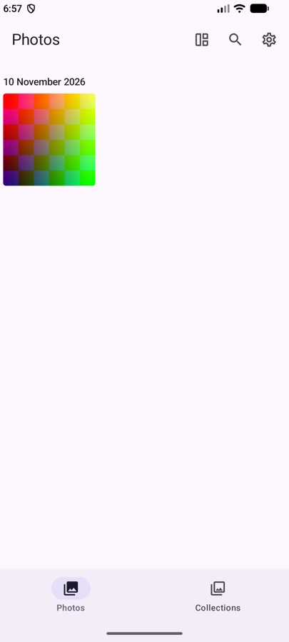 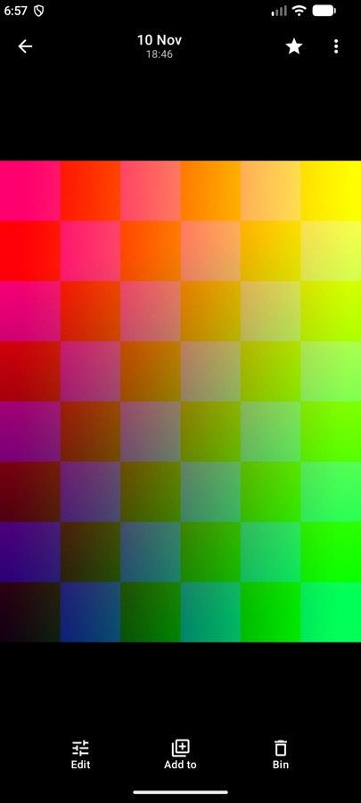 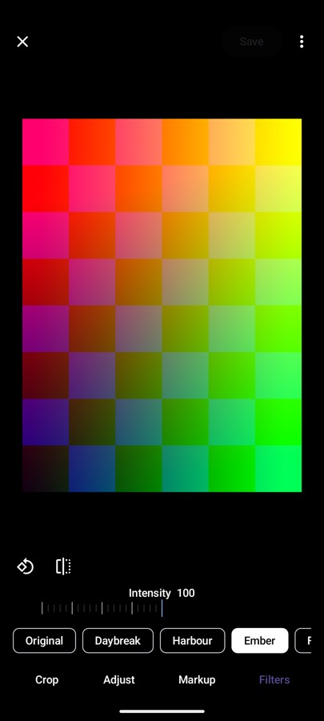 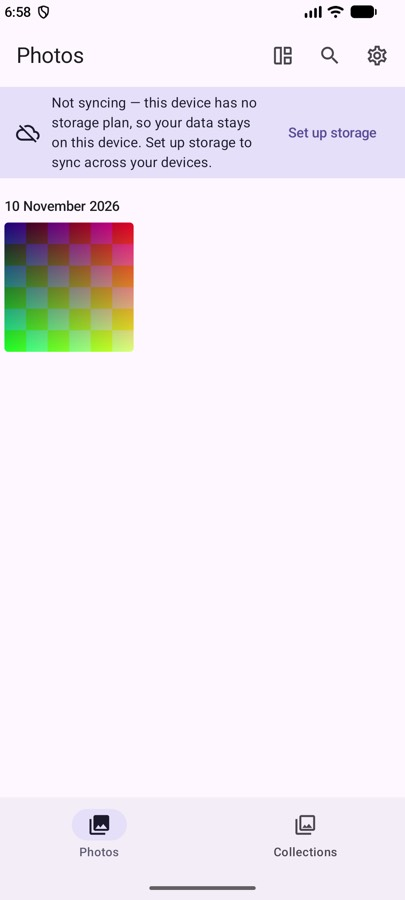 |  |

### 12.12 Not in this slice

- ⚠ **The runtime `SchemaMigrationRegistry.verify()`** still passes a service's first bump with no
  step; only the test is closed (§12.9, `tech-debt.md` for why it is not a one-line fix).
- ⚠ **The index read over IPC is one reply** (~120 B a row): fine to several thousand edits, past that
  it needs paging (§12.9).
- **Orphaned renditions** — a crash between a row change and its file — are counted and never shown;
  nothing sweeps them. A sweep would delete `EDIT_RENDITIONS_ROOT` files no `PhotoEdit` names.
- **Share / Download** do not exist in Photos yet; when they do, they hand out the rendition, and
  the original only as an explicit, warned choice (§12.4).
- ✅ **People avatars no longer come from an edited photo** (closed 2026-11-10, §12.13). ⚠ Labels
  and search vectors still do: the indexer reads originals, and a rendition is under the trash, which
  it skips — so a redaction protects what the photo *shows*, not what the index already learned from
  its original. Consistent with §11.3, and worth revisiting if index data ever leaves the device.
- **Web has no editor**: web Photos shows edits (their renditions, §12.9) and drops an edit with a
  photo deleted forever, but cannot make or revert one.

### 12.13 ⚠⚠ An edited photo never supplies a face avatar (2026-11-10)

The gap: a face box is a fraction of the **original** (the indexer reads originals), and `FaceAvatar`
cuts the crop from whatever path `FaceCover` names — the original's. So a face blacked out with
Redact in a non-destructive edit could still be a person's avatar, on the card, the person header,
the *With…* chip, and iOS's round cover (`SmartAlbum.coverPath`, which follows the face's path).

**Decided: exclusion, not re-detection.** Cropping the rendition instead would need the boxes
re-found on it (a crop or a turn moves them) — a second index of renditions, kept current through
every re-edit and revert. Excluding is one predicate, derived on every read, so a revert makes the
face a candidate again and a re-edit keeps it out with nothing to invalidate. For **every** edit, not
only a redacting one — §12.4's reason: one rule is testable.

- **Live**: `List<FaceGroup>.withoutEditedCovers(photosByPath)` drops from `FaceGroup.faces` every face
  whose photo is mapped edited — or is not in the walk at all (fails closed) — before `peopleFrom`
  picks the largest face. Membership (`filePaths`) is untouched: the photo stays the person's, drawn
  by its rendition; a person whose only faces are edited gets no crop and covers with the rendition.
- **The watch**: the edit index's own observer ticks `LibraryWatch` *after* re-reading the index, and
  the watch vouches only while that observer is live — so an edit made here or synced from a peer
  re-walks Collections, and the walk maps against the new index. Before this the watch saw no edits.
  ⚠ A failed re-read on a change tick marks the observer not live rather than ticking over a stale
  index: `edits()` then re-reads per mapping, and the watch stops vouching until a read succeeds.
- ⚠⚠ **The cache**: the Collections snapshot (`photos-app.md` §36) stores cover paths — a face's is the
  original by construction — and may predate the edit (made on another device while Photos was
  closed). Each snapshot cover now records its photo's `contentId` (`coverContentId`, defaulted, so
  the file format is unchanged), and before a cold start draws it, `CollectionsSnapshot.withoutCoversFrom`
  takes off every cover whose `contentId` is in `PhotosRepository.editedContentIds()` — the edit
  index's keys, ⚠ **not** a library walk (the first build resolved edited ids to paths with
  `readLibrary`, a whole-tree traverse that would have missed the bound on every phone with an edit;
  review finding). A cover with no recorded id is unknown and dropped; a cover that is itself a
  rendition is kept. The read waits at most `SNAPSHOT_EDITS_WAIT_MS` (400 ms), since the snapshot
  exists for a slow Control; unanswered, the snapshot is drawn with no original-path covers at all.
  No other crop is cached: an avatar is cut on the fly from the preview ladder, keyed by path.

Pinned: `PeopleCollectionsTest.aPhotoWithARedactingEdit_neverSuppliesAnAvatarCutFromItsOriginal`
(the edited photo holds the largest face; red without the filter), `…OnlyFaceIsEdited…`,
`aRevertedPhotoCoversAgain_andAReEditedOneStaysOut`; `CollectionsSnapshotTest.aSnapshotFaceCutFromANowEditedOriginal_isNeverDrawn`
`…EditsCannotBeKnown_isDrawnWithNoCovers` (both red without the snapshot filter) and
`aSnapshotCoverWithNoContentId_isNotDrawn_butARenditionCoverIs`; `RealRepositoryReadTest.editedContentIds_…` and, in the library-watch test, *an edit* and *a revert*
written as bare rows (red without the observer's tick).

