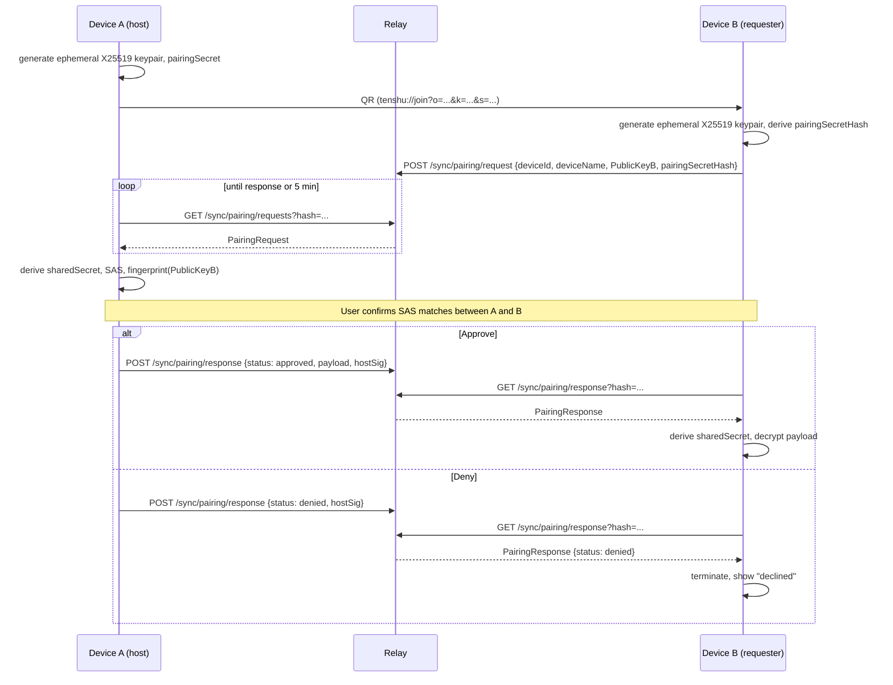

# Pairing Flow — Improvement Proposal

Companion to `pairing-flow.md`. Lists concrete, ordered changes to close the gaps surfaced during
review. Each step says what to change, where in the existing doc, why it matters, and rough effort.

**Status (2026-05-07):** All eight previously-flagged team-decision items are now committed (§0).
The threat-model matrix that Step 1 originally queued is drafted inline in §1. Implementation-level
handoff for Claude Code is in §13. Steps 1–17 are ready for implementation; the proposal is no
longer review-only.

## Priority levels

- **P0** — security-critical. Blocks production use of the flow.
- **P1** — spec completeness. Blocks implementation sign-off because a pair of engineers could
  implement to the current wording and produce incompatible or insecure clients.
- **P2** — clarity, UX, consistency. Should land before the doc is considered final, but doesn't
  block engineering or security.

---

## 0. Decisions Pinned (2026-05-07)

The proposal originally flagged eight items as "team decision" or "suggestion." All are now
committed; the per-step text below is rewritten around these values rather than presenting them as
options. The rationale was worked through in conversation; this section exists so a future reader
can find the committed values without re-reading the whole doc.

| # | Decision                | Committed value                                                                          | Step  |
|---|-------------------------|------------------------------------------------------------------------------------------|-------|
| 1 | Crypto package          | X25519 (KX) + HKDF-SHA-256 (KDF) + XChaCha20-Poly1305 (AEAD) + SHA-256 (hashing)         | §6    |
| 2 | Denied response auth    | Signed by host's device key, verified against `KnownDevicesStore` (master-delegated)     | §10   |
| 3 | Pairing window          | 5 minutes, enforced symmetrically on both host and requester                             | §9    |
| 4 | HKDF info-string format | Namespaced + versioned: `tenshu/pairing/sas/v1`, `tenshu/pairing/keys/v1`                | §2,§6 |
| 5 | Pairing-secret entropy  | 128 bits / 16 bytes / 26-character unpadded base32                                       | §7    |
| 6 | QR URI parameter keys   | Short keys: `o`, `d`, `k`, `s` (URI density matters; keys are not human-read)            | §8    |
| 7 | Background invalidation | 60-second threshold for backgrounded host app                                            | §5    |
| 8 | Terminology             | `realm` everywhere (the proposal originally used `circle` in §11; codebase uses `realm`) | §11   |

The core constraint driving the crypto package is that libsodium-wasm is already on the web track
for Argon2id (the recovery-phrase KDF) — adding it for the pairing handshake is no incremental
bundle cost. Picking the same primitives Signal Protocol uses gives a large prior-art body for any
future external review.

---

## 1. Threat Model

(Drafted from the bullet list previously queued under Step 1.)

The pairing flow is expected to defend against the following threats. "Closes" means the flow
prevents the attack outright; "partial" means the flow narrows the attack surface but does not
eliminate it; "accepts" means the threat is acknowledged and mitigated outside the protocol.

| ID | Threat                                                                                            | Defense                                                                                                                                                                                                                                                            |
|----|---------------------------------------------------------------------------------------------------|--------------------------------------------------------------------------------------------------------------------------------------------------------------------------------------------------------------------------------------------------------------------|
| T1 | Passive eavesdropper on the relay transport                                                       | **Closes.** TLS 1.3 to the relay; the pairing payload is XChaCha20-Poly1305 AEAD-encrypted under a key derived from ephemeral X25519 ECDH (§6). The relay cannot decrypt even the ciphertext it stores.                                                            |
| T2 | Malicious relay operator                                                                          | **Closes for confidentiality, partial for liveness.** The relay only sees the pairing-secret-hash (not the raw secret), the ephemeral public keys, and the AEAD ciphertext. Cannot decrypt. Can deny service by dropping requests; out of scope for this flow.     |
| T3 | Passive QR observer (photograph, screen share, shoulder-surf, screen-reading malware)             | **Partial.** A QR observer can post a `PairingRequest` and complete the handshake from the attacker's device. The SAS comparison (§3.2) and public-key fingerprint (§3.3) on the host's approval prompt let a careful user notice the substituted requester key.   |
| T4 | Active MITM between Device B and the relay                                                        | **Closes.** A MITM substituting their own Public Key B′ derives a different shared secret than Device B; the SAS derived from `(sharedSecret, PublicKeyA, PublicKeyB)` differs between the host (sees B′) and Device B (sees B). User-visible mismatch on the SAS. |
| T5 | Compromised requester device (user approves a rogue device that successfully completed handshake) | **Accepts.** The protocol cannot distinguish a genuine new device from a compromised one once the user has approved. Mitigated by the post-pairing UI making revocation prominent (control-onboarding-ux §6 *Revoke from realm*); see also threat-model T-S-04.    |
| T6 | Stolen or previously-seen pairing secret                                                          | **Closes.** Single-use secret semantics (§3.4): the relay tracks consumed `pairingSecretHash` values with TTL = pairing-window + grace, and rejects any `PairingRequest` or `PairingResponse` referencing a consumed hash.                                         |

Subsequent sections reference these labels (e.g. "§3.2 closes T4") so reviewers can check defense
claims against the matrix.

---

## P0 — Security

### Step 1. Add an explicit threat model section _(content drafted, see §1 above)_

**Where:** new §2a "Threat Model" in `pairing-flow.md`, before §3 of that doc.

**Change:** insert §1 of *this* proposal as §2a of `pairing-flow.md`. Cross-reference the T1–T6
labels from §3 of `pairing-flow.md` whenever a security property is claimed.

**Why:** §4 of `pairing-flow.md` currently lists achievements ("No Long-Lived Secrets on Relay,"
"Mutual Proximity Proof") without a threat model. Without that framing, reviewers can't tell
whether the flow meets its goals, and implementers don't know which properties are load-bearing.

**Effort:** half a day to merge into `pairing-flow.md` (the matrix itself is now drafted).

### Step 2. Add a Short Authentication String (SAS) verification step

**Where:** §3.3 of `pairing-flow.md`, inserted between "receives the PairingRequest" and the
Approve/Deny prompt.

**Change:** after the host derives the shared secret, derive a 6-digit SAS from

```
sasBytes = HKDF-SHA-256(
  ikm    = sharedSecret,
  salt   = PublicKeyA || PublicKeyB,
  info   = "tenshu/pairing/sas/v1",
  length = 4
)
sas = (be32(sasBytes) >> 12) % 1_000_000     // first 20 bits → 6-digit decimal, zero-padded
```

⚠⚠ **Superseded for the join flow (2026-10-03):** the join SAS is now v2 —
`info = "tenshu/pairing/sas/v2" || lp(joiner signing key) || lp(joiner deviceId) || lp(joiner name)`,
same salt and truncation — because v1 left the joiner's identity relay-chosen (threat model
T-P-14). Lockstep, no fallback. The offer flow still uses v1 as written here.

Device B derives the same value independently and displays it. The host's approval prompt
becomes:

> "Device 'John's iPad' wants to join your realm. Confirm the code `482913` matches on the
> other device. [Approve] [Deny]"

A test vector is pinned in §13 (Implementation Notes for Claude Code → Test fixtures); the
canonical SAS for the fixed inputs there must match across all platforms.

**Why:** §4 of `pairing-flow.md`'s "Mutual Proximity Proof" claim is stronger than the flow
actually delivers. An attacker who observes the QR can post their own Public Key B′ and derive a
shared secret with the host — the host's approval is based on an attacker-chosen `deviceName` with
nothing cryptographically tying it to the real requester. A SAS derived from both ephemeral public
keys surfaces any substitution to a human: the MITM's SAS differs from the one Device B shows. This
is the same mechanism Signal and WhatsApp use for verification. Closes T4.

**Effort:** one day of crypto plumbing (HKDF over both public keys + secret), plus a UI tweak on
both host and requester. The UI text is already drafted in control-onboarding-ux §4a.4 and §6.3.

### Step 3. Show a Public Key B fingerprint on the approval prompt

**Where:** §3.3 of `pairing-flow.md`.

**Change:** alongside the SAS (Step 2), display a short fingerprint derived from Public Key B:

```
fpBytes = SHA-256(PublicKeyB)[0..8]              // first 8 bytes
fingerprint = base32(fpBytes)                    // 13 base32 chars, unpadded
formatted = fingerprint[0..4] + "-" + fingerprint[4..8] + "-" + fingerprint[8..13]
                                                 // e.g. "F4A29-C71K8-M3X9P"
```

Render in the host UI as `XXXXX-YYYYY-ZZZZZ`, matching the format already specified in
control-onboarding-ux §6.3.

**Why:** defense in depth. If the host user skips the SAS comparison out of habit, the fingerprint
at least anchors approval to the actual public key rather than to an attacker-chosen `deviceName`.
Small, cheap, and makes the approval UI feel substantive rather than a rubber stamp.

**Effort:** trivial. SHA-256 is already in the crypto module; base32 encoder already exists for
`Bech32` / pairing-secret encoding.

### Step 4. Specify single-use semantics for the pairing secret

**Where:** §2 and §3.1 of `pairing-flow.md`.

**Change:** add explicit statements:

- The pairing secret is **single-use**. After the host issues Approve or Deny, or after the pairing
  window expires, the secret (specifically its `pairingSecretHash`) is invalidated.
- Any subsequent `PairingRequest` or `PairingResponse` referencing a consumed `pairingSecretHash`
  is rejected by the relay with `409 Conflict`.
- The relay tracks consumed `pairingSecretHash` values with a TTL equal to the pairing window
  (5 min, see §9) plus a 30-second grace period.

Note: the wire schema already uses `pairingSecretHash` rather than the raw secret (see
`sync-service/src/commonMain/kotlin/org/tenshu/sync/PairingRequest.kt`), so the relay infrastructure
to compare hash-vs-hash exists; what's missing is the `ConsumedPairingSecretsStore` and the
endpoint-level rejection.

**Why:** today's relay routing for `POST /sync/pairing/request` accepts the same hash repeatedly
without dedup, so replays of a captured request succeed (and a captured request, even after Deny,
can be re-submitted to confuse the host). Closes T6.

**Effort:** doc change is small; relay needs a "consumed secrets" set with TTL eviction. The
natural shape is a sibling to `KnownDevicesStore` (see §13) — `ConsumedPairingSecretsStore` keyed
by `pairingSecretHash`, with `(insertedAt, expiresAt)` for TTL eviction.

### Step 5. List all triggers that invalidate the host's PairingContext

**Where:** §2 and §5 of `pairing-flow.md`.

**Change:** state explicitly that the host's `PairingContext` (ephemeral keys + secret + any
pending-request state, currently tracked in `SyncManagerImpl.pendingHandshakes` and the
`activePairingContext` field) is invalidated when any of the following happens:

1. The host user taps Approve or Deny.
2. The QR dialog is closed or dismissed (navigation event).
3. The pairing window (5 min, see §9) expires.
4. The app is backgrounded continuously for more than **60 seconds**.
5. The device locks (OS-level lock screen).

On invalidation:

- The ephemeral private key is zeroed (`ByteArray.fill(0)`).
- The `pairingSecretHash` is added to the consumed-secrets set on the relay (§4).
- The corresponding entry in `pendingHandshakes` is removed.
- Any in-flight polling on the requester side that subsequently posts a request for that hash will
  receive `409 Conflict` from the relay.

**Why:** §4 of `pairing-flow.md` hints at "burning" the handshake but leaves the triggers implicit.
Make the full list concrete so every client implements the same behaviour and reviewers have
something to check against.

**Effort:** doc change small; client-side wiring of triggers 1–5 in `SyncManagerImpl` plus an
`InvalidationReason` enum is roughly a half-day. Persistence of `pendingHandshakes` across
proxy-process death is tracked separately in tech-debt §"Pairing Handshake State — In-Memory Only"
and is not in scope here.

---

## P1 — Spec Completeness

### Step 6. Pin the cryptographic primitives

**Where:** new §6 "Cryptographic Primitives" in `pairing-flow.md`.

**Change:** the protocol pins the following primitives:

| Purpose                            | Primitive          | Notes                                                                               |
|------------------------------------|--------------------|-------------------------------------------------------------------------------------|
| Ephemeral key exchange             | X25519             | 32-byte private key, 32-byte public key. Same curve as Signal/WhatsApp/WireGuard.   |
| Key derivation                     | HKDF-SHA-256       | Domain-separated `info` strings: `tenshu/pairing/sas/v1`, `tenshu/pairing/keys/v1`. |
| AEAD                               | XChaCha20-Poly1305 | 24-byte random nonce per encryption (random-nonce-safe).                            |
| Hashing (fingerprint, secret hash) | SHA-256            | Truncated to first 8 bytes for the public-key fingerprint.                          |

Versioning rule: when any primitive changes, the version segment of every affected info string
bumps to `v2`. Old clients reject `v2` info strings; new clients reject `v1` once support is
removed. There is no in-protocol negotiation — version mismatch is a hard error with a "please
update your app" UI.

**Why:** "ephemeral ECC key pair" is not a spec. Every engineer who picks the curve themselves is
an incident waiting to happen, and cross-platform interop dies silently. Picking these specifically
also matches what `:core-common`'s crypto path already pulls in (per tech-debt §"Crypto Backend
Selection for Web") so there is no incremental dependency cost.

**Effort:** doc-only at the spec level. Implementation hooks into the libsodium-wrapping crypto
module (existing on JVM/Android, libsodium-wasm on JS).

### Step 7. Specify the pairing-secret format

**Where:** §3.1 of `pairing-flow.md`.

**Change:** the pairing secret is:

- **128 bits of entropy** drawn from a CSPRNG (16 random bytes).
- Encoded as **unpadded base32, lowercase on the wire, case-insensitive on input**.
- **26 characters long** (16 bytes × 8 bits / 5 bits per base32 char = 25.6, padded up to 26).
- Formatted for the manual-entry fallback as `XXXX-XXXX-XXXX-XXXX-XXXXXXXXXX` (four 4-character
  groups plus one 10-character tail), with hyphens stripped before parsing.

The `pairingSecretHash` field on the wire is `SHA-256(rawSecret)` rendered as base16 (hex), 64
characters.

**Why:** "high entropy" is not implementable. Encoding choice affects QR density and the
manual-entry fallback's typability. base32 is case-insensitive and fits comfortably in QR
alphanumeric
mode (45-character set) without dropping into binary mode.

**Effort:** doc-only. The encoder/decoder lives next to the existing `Bech32` helper in
`:core-common/util/`.

### Step 8. Specify the QR payload format

**Where:** §3.1 of `pairing-flow.md`.

**Change:** the QR encodes a self-describing URI whose **host is a role token** under the house
`tenshu://` scheme:

```
tenshu://join?o=<ownerId>&d=<hostDeviceId>&k=<base32(PublicKeyA)>&s=<base32(pairingSecret)>
```

(Renamed from `tenshu-pair:v1` on 2026-07-05, in two steps settled the same day: the discriminator
is a role, not a version — `join` = existing device displays, new device scans; `offer` = the
inverse, specced in [`sync-pairing-inverted-direction.md`](sync-pairing-inverted-direction.md) —
and the scheme is the existing `tenshu://` with the role as host, matching `tenshu://epc/pair#…`
and the planned `tenshu://checkout-result`, and parseable by standard URL libraries. The two forms
coexist permanently rather than succeed one another. **The legacy `tenshu://pair?…` form is removed
with no compatibility shim** — the installed base is essentially the maintainer's own devices, so
`getPairingString()` and all parsers flip in one flag-day change; a scanned `tenshu://pair?…` code
gets a "generate a new code on the other device" error. Migration details live in the
inverted-direction proposal's §6 P1 + §8.)

Parameter keys are short (`o`, `d`, `k`, `s`) to keep the QR dense — this is a machine-read field;
density at fixed display size matters for scanning in poor lighting.

| Key | Field           | Encoding                              |
|-----|-----------------|---------------------------------------|
| `o` | `ownerId`       | Bech32-encoded master public-key hash |
| `d` | `hostDeviceId`  | base32                                |
| `k` | `PublicKeyA`    | base32, 32 bytes raw → 52 chars       |
| `s` | `pairingSecret` | base32, 16 bytes raw → 26 chars       |

Client behaviour on an unrecognised role host (e.g. `tenshu://offer?...` against a client that
predates it): show the user-visible error *"This pairing code requires a newer version of Tenshu.
Update your app and try again."* The retired legacy `tenshu://pair?...` host gets the inverse
message ("generate a new code on the other device"). No attempt to parse either.

**Why:** without a discriminated, documented format, every client parses it slightly differently and
the format can't evolve without breaking older apps. Discriminating at the URI level (vs HTTP-style
content negotiation) is appropriate because the QR is a one-shot static artifact.

**Effort:** doc-only.

### Step 9. Define polling cadence and the pairing window

**Where:** §5 of `pairing-flow.md`.

**Change:** replace the hand-wave of "polling" with:

- Requester polls `GET /sync/pairing/response?hash=<pairingSecretHash>` every **2 s** for the first
  30 s, then every **5 s** until the pairing window expires.
- Host polls `GET /sync/pairing/requests` every **2 s** while the QR dialog is visible.
- Both sides apply exponential backoff with jitter on HTTP 5xx errors (cap: 30 s).
- The pairing window is **5 minutes** for *both* sides. After that, the host's context is
  invalidated (even if the user has not dismissed the dialog) and the relay rejects further traffic
  for that `pairingSecretHash`.

Long-poll on `/sync/pairing/response` is an optional optimisation (sync-relay-api.md §3) and not
required by this spec; the polling-cadence numbers above are the floor.

**Why:** today's `pairing-flow.md` puts the 5-minute timeout on the requester only. Without
symmetric host-side semantics, a late Approve either races with a timed-out requester (UX
confusion) or piles up on the relay forever.

**Effort:** doc change plus relay-side TTL enforcement (see §13 → `ConsumedPairingSecretsStore`).

### Step 10. Define the Denied response path

**Where:** §3.3 of `pairing-flow.md` and protocol schema in `:sync-service` /
`:sync-service-common`.

**Change:** on Deny, the host posts a `PairingResponse { status: "denied" }` to
`POST /sync/pairing/response`. The response is signed by the host's device key using the same
master-delegation signing path that the existing Approve response uses (`MasterDelegationVerifier`
in `:sync-relay-server`). The relay verifies the signature against `KnownDevicesStore` before
accepting; the requester verifies the signature on receipt.

Wire shape (CBOR-encoded body):

```
PairingResponse {
  status:         "approved" | "denied"
  payload:        bytes?       // present iff status == "approved"; AEAD ciphertext per §11
  hostSignature:  bytes        // Ed25519 over canonical(status || hash || payload)
}
```

Device B treats `status: "denied"` as a terminal state and shows *"The other device declined this
request"* immediately rather than waiting for the timeout.

**Why:** the previous spec left Device B in a silent wait state for up to 5 minutes after a refused
pairing — bad UX, unnecessary battery drain, and (combined with single-use-secret semantics from
§4) exposed the requester to a denial-of-pairing attack: anyone who observed the QR could send a
spoofed plaintext "denied" to grief the user. The signed Denied closes that gap; it's not a new
auth path because `/sync/pairing/response` is already master-delegation-signed.

**Effort:** one new field on the response schema, one UI branch on the requester, one signature
verification on the relay (which is already there for Approve responses; just needs to be enforced
when `status == "denied"`).

### Step 11. Define the exact pairing payload

**Where:** §3.3 of `pairing-flow.md` and new §6a "Pairing Payload" in `pairing-flow.md`.

**Change:** name the fields that cross the wire on Approve. Final shape:

```
PairingPayload {
  masterIdentityPrivateKey: bytes        // Ed25519 32-byte seed
  realmEpochKeys:           List<bytes>  // all currently-active realm-epoch keys
  volumeKeys:               List<bytes>  // one entry per volume the user owns
  ownerMetadata: {
    displayName:        string
    realmCreatedAtUnix: int64
  }
}
```

Explicitly excluded: keys from revoked devices, past-epoch keys already ratcheted out.

AEAD construction:

```
ciphertext = XChaCha20-Poly1305(
  key       = HKDF-SHA-256(
    ikm    = sharedSecret,
    salt   = PublicKeyA || PublicKeyB,
    info   = "tenshu/pairing/keys/v1",
    length = 32
  ),
  nonce     = randomBytes(24),
  plaintext = CBOR(PairingPayload),
  aad       = PublicKeyA || PublicKeyB || pairingSecretHash
)
```

The wire-format `PairingResponse.payload` is `nonce || ciphertext` (the 24-byte nonce prefixed; the
Poly1305 tag is included in `ciphertext` per the AEAD construction).

**Why:** previously "Master Identity Keys" was a black box. The blast radius of a compromised
pairing equals the contents of that box, so the contents must be spelled out. Binding the
ciphertext to both public keys and the secret hash via AAD prevents a cross-session replay where an
attacker substitutes a response from a different pairing attempt.

Field-naming note: this proposal previously used `circleEpochKeys` and `circle-created-at`. The
codebase, threat-model, and onboarding-ux docs all use **realm**, not **circle** — the rename is
applied throughout this revision.

**Effort:** half a day to draft the schema additions in `:sync-service-common`, plus a cross-check
with whoever owns `SyncCryptoManager` for the ciphertext format.

### Step 12. Specify post-pairing key lifetime and storage

**Where:** new §6b "Post-Pairing Key Handling" in `pairing-flow.md`.

**Change:** state where the newly-received keys live on Device B:

- `masterIdentityPrivateKey` is held in memory only (per threat-model T-K-04: re-derived from the
  recovery phrase on next app launch). **Not** written to disk.
- `realmEpochKeys` and `volumeKeys` are stored via `SecureStorageDelegate` (Keychain on
  iOS/macOS, Android Keystore on Android, libsecret/credstore-equivalent on Linux/Windows).
- Both ephemeral private keys, the shared secret, and the raw `pairingSecret` are zeroed
  immediately after the payload is decrypted.
- The `pairingSecretHash` may persist long enough for the requester to ack receipt; see §13's
  *"Cleanup ordering"* note.

**Why:** a flow that is secure on the wire but drops plaintext keys into
`~/Library/Application Support/` isn't secure. This is also where past incidents tend to be found
retrospectively, so state it up front.

**Effort:** doc-only on the spec side; implementation hooks into existing `SecureStorageDelegate`
plumbing.

---

## P2 — Clarity, UX, Consistency

### Step 13. Document the first-device bootstrap

**Where:** new §2b in `pairing-flow.md`, one paragraph.

**Change:** "When a user has no existing devices in their realm, the first device does not pair.
It generates the master identity and volume keys locally (per recovery-phrase setup in
control-onboarding-ux §4b.2) and uploads only its own public device record to the relay. The
pairing flow described in §3 applies only to second and subsequent devices."

**Why:** a reader of the current doc comes away thinking every device goes through the handshake.
The "This Device" badge mentioned in §5 of `pairing-flow.md` is the only hint otherwise.

**Effort:** trivial.

### Step 14. Align the doc's polling wording with the actual relay endpoint

**Where:** §3.1 of `pairing-flow.md`.

**Change:** the current relay returns all pending requests for the `ownerId` and lets the host
filter client-side. The doc previously implied server-side filtering by secret. Pick: server-side
filter by `pairingSecretHash` is the more secure option (the host never sees unrelated pairing
attempts for its `ownerId`). Wire this in `:sync-relay-server/routing/SyncRouting.kt` —
`GET /sync/pairing/requests?hash=<pairingSecretHash>`.

**Why:** today's doc and implementation disagree. Server-side filtering also reduces the surface
for a confused-deputy bug where the host implementation forgets to filter and approves the wrong
request.

**Effort:** small either way; preferred direction is the server-side filter.

### Step 15. `deviceName` in the `PairingRequest` schema

**Where:** §3.2 of `pairing-flow.md` and `:sync-service/PairingRequest.kt`.

**Change:** the schema already carries `deviceName` (verified 2026-05-07 — see `PairingRequest.kt`
field definitions). No code change required; the original Step 15 from the previous revision is
**already done**. Update `pairing-flow.md`'s prose to match.

**Why:** the doc previously implied this was missing.

**Effort:** doc-only.

### Step 16. Unify terminology

**Where:** global, both this doc and `pairing-flow.md`.

**Change:** "master identity keys" and "master identity and volume keys" both appear. Pick **
"master identity and volume keys"** for the full payload (matches Step 11) and **"master identity
key"** when referring specifically to the Ed25519 keypair. Define both in §1 of `pairing-flow.md`.

The `circle` → `realm` rename is also applied throughout this revision (see §0 decision 8).

**Why:** identity-critical docs don't get to be ambiguous about what they're protecting.

**Effort:** search-and-replace.

### Step 17. Add a sequence diagram

**Where:** top of §3 of `pairing-flow.md`.

**Change:** a Mermaid sequence diagram showing Device A, Device B, and the relay, with the
four-step flow plus the SAS comparison (Step 2) and the Denied path (Step 10). Sketch:



**Why:** the prose is clear, but a diagram is faster to scan for missing arrows and reviewers catch
gaps that prose glosses over.

**Effort:** half a day in Mermaid.

---

## Verification / Review Step

Before the revised `pairing-flow.md` is published:

1. Walk each of T1–T6 from §1 through each step of the revised §3 of `pairing-flow.md` and confirm
   the defense is explicit in the text (not "clearly implied").
2. Diff the `PairingRequest` and `PairingResponse` schemas in the doc against the Kotlin types in
   `sync-relay-server` and `sync-service-common`. They must match byte-for-byte — including field
   order, since these go through the binary serializer.
3. Have a teammate (or Claude Code) who hasn't seen the flow implement a mock client against the
   revised §3 and log every question asked. Each question is a spec gap.
4. Run the revised flow past whoever owns relay rate-limiting / abuse. Steps 4, 5, and 9 have real
   relay-side implications that should be sanity-checked before they're written in stone.

---

## Suggested Ordering

If engineering capacity is tight: land **P0 (Steps 1–5)** first, even as a standalone security
addendum to `pairing-flow.md`. These are the ones that affect whether the flow is safe to ship.
**P1 (Steps 6–12)** should land before anyone writes more pairing code against the spec, because
the current wording under-specifies the wire format. **P2 (Steps 13–17)** is docs hygiene and can
follow.

The full sequence is also amenable to a single phase if Claude Code is doing the implementation —
the file-level changes are well-bounded (see §13).

---

## 13. Implementation Notes for Claude Code

A consolidated, file-level handoff. If something below contradicts §0–§12, §0–§12 wins; this
section exists to remove ambiguity for an autonomous agent.

### Order across in-flight docs

1. **This doc's Steps 1–5 (P0)** — can land standalone. No dependency on other in-flight proposals.
2. **Steps 6–12 (P1)** — depend only on the crypto-package and HKDF info-string decisions in §0;
   no other proposal needs to land first.
3. Tombstone relay-side GC (landed; see [ADR 0006](../adr/0006-sync-tombstones.md)) — independent
   track. The `ConsumedPairingSecretsStore` added in this work is structurally similar to
   `TombstoneRegistry` but does not share storage.
4. `sync-relay-api.md` Phase 3 (long-poll on pairing) — optional follow-up. The polling cadences
   in §9 of this doc are the protocol floor; long-poll is a transparent optimisation on top.
5. `sync-backend-relay-plan.md` Phase 3.1 (HLC piggyback) — unrelated; does not gate this work.

### Naming during the migration window

- **`circle` is already gone from the codebase.** Any remaining `circle` references in this proposal
  are stale; the implementation uses `realm` throughout. New code uses `realm`; do not introduce
  `circle` even temporarily.
- **`pairingSecretHash` (not `pairingSecret`)** is the wire-level field name. The raw secret is
  client-side only.
- **`ConsumedPairingSecretsStore`** is the chosen name for the relay-side dedup component
  (structural sibling to `KnownDevicesStore` in `:sync-relay-server/auth/`).

### Module dependencies (build.gradle)

No new module-graph changes. Specifically:

- `:core-common` already exposes the crypto primitives via `SyncCryptoManager`; the new SAS and
  fingerprint helpers are additive in `:core-common/util/`.
- `:sync-service` already declares `PairingRequest`; adding `PairingResponse` (composite with
  `status`, `payload`, `hostSignature` fields) is internal to the module.
- `:sync-service-common` already exposes the wire-DTO machinery (`PairingRequestDto`); add
  `PairingResponseDto` next to it.
- `:sync-service-proxy` already imports `:sync-service-common` and `:core-common`; new wiring in
  `SyncManagerImpl` is internal.
- `:sync-relay-server` adds `ConsumedPairingSecretsStore` next to `KnownDevicesStore`; no new
  module dependency.

### File-level migration table

**New files:**

| Path                                                                                          | Contents                                                                                                                                       |
|-----------------------------------------------------------------------------------------------|------------------------------------------------------------------------------------------------------------------------------------------------|
| `core-common/src/commonMain/kotlin/org/tenshu/core/common/util/PairingSas.kt`                 | `fun deriveSas(sharedSecret, publicKeyA, publicKeyB): String` — returns 6-digit zero-padded decimal per §2.                                    |
| `core-common/src/commonMain/kotlin/org/tenshu/core/common/util/PairingFingerprint.kt`         | `fun computeFingerprint(publicKey): String` — returns `XXXXX-YYYYY-ZZZZZ` per §3.                                                              |
| `core-common/src/commonMain/kotlin/org/tenshu/core/common/util/PairingSecret.kt`              | `fun generatePairingSecret(): RawSecretAndHash` (returns 16-byte secret + its SHA-256 hex hash); also encode/decode helpers for the URI form.  |
| `sync-service/src/commonMain/kotlin/org/tenshu/sync/PairingResponse.kt`                       | New `Composite` schema with `status: TString`, `payload: TByteArray?`, `hostSignature: TByteArray`.                                            |
| `sync-service-common/src/commonMain/kotlin/org/tenshu/sync/common/PairingResponseDto.kt`      | DTO mirror of `PairingResponse`.                                                                                                               |
| `sync-relay-server/src/main/kotlin/org/tenshu/sync/relay/auth/ConsumedPairingSecretsStore.kt` | TTL-evicted set keyed by `pairingSecretHash`. In-memory acceptable for v1; document migration path to persistent store in tech-debt if needed. |

**Modified files:**

| Path                                                                                                               | Change                                                                                                                                                                                                                                                                                             |
|--------------------------------------------------------------------------------------------------------------------|----------------------------------------------------------------------------------------------------------------------------------------------------------------------------------------------------------------------------------------------------------------------------------------------------|
| `sync-service-proxy/src/commonMain/kotlin/org/tenshu/sync/proxy/SyncManagerImpl.kt`                                | (a) Wire the five invalidation triggers from §5; (b) on invalidation, call `pendingHandshakes.remove(...)` *and* zero the ephemeral private key bytes; (c) compute SAS + fingerprint when handling `GetPendingPairingRequests` results so the UI layer can display them.                           |
| `sync-service-proxy/src/commonMain/kotlin/org/tenshu/sync/proxy/impl/ApprovePairingRequestImplementation.kt`       | Construct `PairingResponse{status: "approved", payload: <AEAD>, hostSignature: <Ed25519>}`. Use the AEAD construction in §11 with `info = "tenshu/pairing/keys/v1"`.                                                                                                                               |
| `sync-service-proxy/src/commonMain/kotlin/org/tenshu/sync/proxy/impl/` (new) `DenyPairingRequestImplementation.kt` | Construct `PairingResponse{status: "denied", payload: null, hostSignature: <Ed25519>}` and POST to `/sync/pairing/response`.                                                                                                                                                                       |
| `sync-service/src/commonMain/kotlin/org/tenshu/sync/` (new) `DenyPairingRequest.kt`                                | New op interface, parallel to `ApprovePairingRequest`, with the same `deviceId` parameter.                                                                                                                                                                                                         |
| `sync-relay-server/src/main/kotlin/org/tenshu/sync/relay/routing/SyncRouting.kt`                                   | (a) `POST /sync/pairing/request`: reject if `pairingSecretHash` is in `ConsumedPairingSecretsStore`, return 409. (b) Add `?hash=<pairingSecretHash>` filter to `GET /sync/pairing/requests`. (c) On `POST /sync/pairing/response`, mark `pairingSecretHash` consumed regardless of approve/denied. |
| `sync-relay-server/src/main/kotlin/org/tenshu/sync/relay/auth/MasterDelegationVerifier.kt`                         | Extend canonical-message construction to cover `status: "denied"` responses (today only handles approved). The signed bytes for Denied are `canonical(status \|\| pairingSecretHash)` — no payload.                                                                                                |
| `control-shared/src/commonMain/kotlin/app/tenshu/control/ui/screens/sync/PairingWizardViewModel.kt`                | Surface SAS + fingerprint to the wizard UI. The screens for both are already specified in `control-onboarding-ux.md` §4a.4 (requester) and §6.3 (host).                                                                                                                                            |
| `docs/sync/pairing-flow.md`                                                                                        | Apply Steps 1, 2, 3, 4, 5, 6, 7, 8, 9, 10, 11, 12, 13, 14, 17 inline (the spec doc is the consumer of this proposal).                                                                                                                                                                              |
| `docs/sync/threat-model.md`                                                                                        | Add a section referencing the T1–T6 matrix from §1 of this proposal; cross-link from any A4-related entries.                                                                                                                                                                                       |

### Test fixtures

**Pinned test vector for `PairingSas.deriveSas`:**

```
PrivateKeyA  = 0x0101010101010101010101010101010101010101010101010101010101010101
PrivateKeyB  = 0x0202020202020202020202020202020202020202020202020202020202020202
PublicKeyA   = X25519.publicKey(PrivateKeyA)         // deterministic
PublicKeyB   = X25519.publicKey(PrivateKeyB)         // deterministic
sharedSecret = X25519.sharedKey(PrivateKeyA, PublicKeyB)
                                                     // == X25519.sharedKey(PrivateKeyB, PublicKeyA)

EXPECTED_SAS = <TBD: pin on first cross-platform implementation>
EXPECTED_FINGERPRINT_B = <TBD: pin on first cross-platform implementation>
```

The `<TBD>` values are computed by the first platform's implementation and asserted from then on
across JVM, JS, and any future platform actuals. A divergence between platforms is a hard test
failure indicating a primitive-implementation mismatch.

**Test files to add:**

- `core-common/src/commonTest/kotlin/.../util/PairingSasTest.kt` — asserts the pinned vector;
  verifies that flipping a single bit in `PublicKeyB` changes the SAS.
- `core-common/src/commonTest/kotlin/.../util/PairingFingerprintTest.kt` — asserts the pinned
  vector; format check (`XXXXX-YYYYY-ZZZZZ`).
- `core-common/src/commonTest/kotlin/.../util/PairingSecretTest.kt` — entropy assertion
  (32 generations have no collision); base32 round-trip.
- `sync-service-proxy/src/commonTest/kotlin/.../PairingDeniedPathImplementationTest.kt` — host posts
  signed `status: "denied"`; requester receives, signature verifies, UI state transitions to the
  terminal "declined" state without timeout.
- `sync-service-proxy/src/commonTest/kotlin/.../PairingContextInvalidationTest.kt` — exercises the
  five invalidation triggers from §5; asserts that the ephemeral private key has been zeroed and
  that subsequent operations return `409 Conflict`.
- `sync-relay-server/src/test/kotlin/.../PairingSecretSingleUseTest.kt` — second submission of the
  same `pairingSecretHash` returns 409 within the TTL window.
- `sync-relay-server/src/test/kotlin/.../PairingResponseHashFilterTest.kt` —
  `GET /sync/pairing/requests?hash=...`
  returns only the matching pending request.

**Test fixtures to update, not just add:**

- `ApprovePairingRequestImplementationTest` — the response wire shape changes (`PairingResponse`
  composite instead of raw payload bytes); update assertions accordingly.
- `SyncRelayTest` — `pairingSecretHash` consumption needs a new branch covering Approve, Deny,
  and timeout-expiry paths.
- `SyncEndpointAuthTest` — confirm the Denied response path is master-delegation-signed (already
  the case for Approve).

### Cleanup ordering

When the host receives an Approve response and the requester acks it (i.e. the requester has
successfully decrypted), the relay should mark `pairingSecretHash` consumed and the host should
remove its `pendingHandshakes` entry. The order matters: the relay marks consumed *before* it
returns the response payload to the requester (so a replayed `GET /sync/pairing/response` after
ack can still serve the cached response, but a fresh `POST /sync/pairing/request` for the same
hash is rejected).

### Open questions to resolve before merge

- **Ack mechanism for "the requester successfully decrypted."** Today the host has no signal that
  the requester completed the handshake. Options:
  - (a) Implicit via TTL — the relay drops the response after the pairing window regardless.
    Simple, accepted footgun if the requester crashes mid-decrypt.
  - (b) Explicit ack — the requester posts `POST /sync/pairing/ack {pairingSecretHash}` after
    successful decryption. The relay then deletes the response payload. Adds an endpoint and
    a TTL fallback for the case where ack never arrives.
  - Recommended: (a) for v1, document (b) as a follow-up. The 5-min TTL is short enough that
    retention isn't a real concern.
- **Versioned vs un-versioned `info` strings on already-pinned primitives.** The first version is
  `v1`. When (not if) we bump primitives, we'll need a strategy for in-flight pairings — either
  fail them with "update your app" or maintain v1 verifiers indefinitely. Pick at the time of
  v2; not a v1 blocker.
- **Where the master-delegation `MasterDelegationVerifier` validates the `realm` of the host's
  device key.** Today it validates the key against `KnownDevicesStore`; a host whose device was
  revoked between QR generation and Approve would currently still see its signature verified.
  Cross-cutting with the landed relay-side rejection of revoked-device pushes
  ([ADR 0006](../adr/0006-sync-tombstones.md)); not adding scope here.

### What changes in `SyncManagerImpl` (sequence)

```
SyncManagerImpl.handlePairingApproveResponse(response):
  1. Verify response.hostSignature against KnownDevicesStore for the host device. (Existing.)
  2. NEW: Compute fingerprint = SHA-256(PublicKeyA)[:8] base32 — match against the value
     displayed during the SAS step? (Optional sanity check; the SAS already binds.)
  3. Derive sharedSecret = X25519.sharedKey(ephemeralPrivateKeyB, PublicKeyA).
  4. Derive aeadKey = HKDF-SHA-256(sharedSecret, salt=PublicKeyA||PublicKeyB,
                                   info="tenshu/pairing/keys/v1", length=32).
  5. Decrypt response.payload (nonce || ciphertext) with aeadKey, AAD as in §11.
  6. Parse CBOR(plaintext) → PairingPayload.
  7. Hand keys to SyncCryptoManager.installRecoveredKeys(...).
  8. Zero(ephemeralPrivateKeyB), zero(sharedSecret), zero(aeadKey), zero(rawPairingSecret).
  9. pendingHandshakes.remove(pairingSecretHash).
 10. Return Success.
```

```
SyncManagerImpl.handlePairingDenyResponse(response):
  1. Verify response.hostSignature against KnownDevicesStore. (NEW path.)
  2. NEW: Surface terminal "declined" state to the wizard ViewModel.
  3. Zero(ephemeralPrivateKeyB), zero(rawPairingSecret).
  4. pendingHandshakes.remove(pairingSecretHash).
  5. Return TerminalDenied.
```

### Tests that need updating, not just adding

(See "Test fixtures to update" above.)

---

## 14. References

- [`docs/sync/pairing-flow.md`](../sync/pairing-flow.md) — the spec doc this proposal updates.
- [`docs/sync/threat-model.md`](../sync/threat-model.md) — receives the T1–T6 cross-references and
  any related amendments.
- [`docs/proposals/control-onboarding-ux.md`](control-onboarding-ux.md) §4a.4, §6.3 — already
  written against the SAS + fingerprint UX this proposal commits to.
- [`docs/proposals/web-onboarding-ux.md`](web-onboarding-ux.md) §4a.2 — same, web side.
- [`docs/proposals/sync-relay-api.md`](sync-relay-api.md) §3 — the relay endpoints touched
  by §4, §9, §10, §14.
- [`docs/tech-debt.md`](../tech-debt.md) §"Pairing Handshake State — In-Memory Only",
  §"Crypto Backend Selection for Web", §"Kotlin-side Bundle Splitting" — adjacent items not in
  scope here but worth knowing about.
- [`docs/proposals/sync-relay-api.md`](sync-relay-api.md) §9 — Implementation Notes
  template this proposal's §13 follows.
